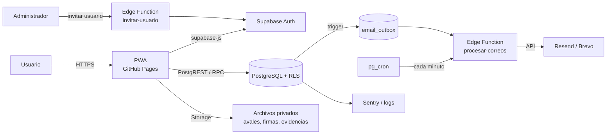
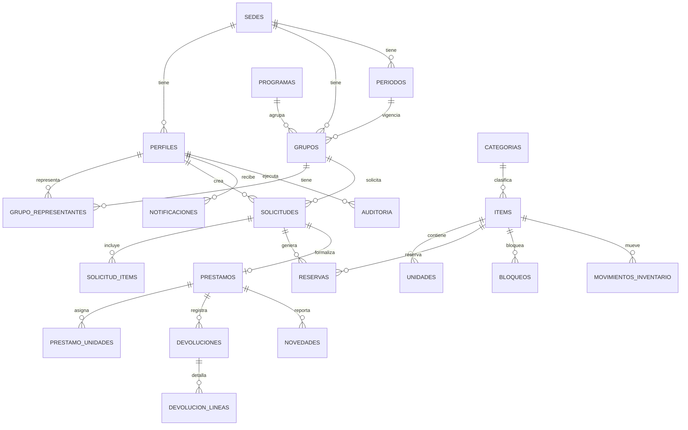
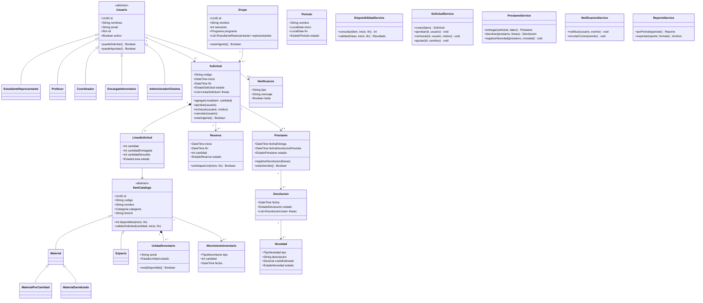

# Arquitectura, modelo de datos y diseño orientado a objetos
## Sistema de Préstamo de Materiales y Espacios – UT CAT Medellín

> **Versión:** 1.0 · **Fecha:** noviembre de 2026
> **Relacionado:** [`PLAN-MAESTRO.md`](./PLAN-MAESTRO.md) · [`REQUISITOS.md`](./REQUISITOS.md)

---

## 1. Principios de diseño

1. **El servidor manda.** La interfaz oculta acciones, pero la base de datos y las funciones validan permisos, disponibilidad y estados.
2. **Una sola fuente de verdad.** Usuarios, grupos, ítems, reservas y préstamos viven en PostgreSQL; `localStorage` solo se usa para borradores y caché de lectura.
3. **La disponibilidad es por rango de fechas.** No se calcula con el stock “de hoy”, sino con las reservas que se solapan con el periodo solicitado.
4. **Todo movimiento es transaccional y auditado.** Aprobar, entregar, devolver o ajustar inventario ocurre en una transacción atómica y deja rastro.
5. **Diseño orientado a objetos en el dominio.** Las clases representan el negocio; los servicios orquestan; los repositorios acceden a datos. La UI no contiene reglas.
6. **Portabilidad.** PostgreSQL estándar y una capa de repositorios permiten migrar de Supabase a un servidor institucional sin reescribir el dominio.

---

## 2. Stack recomendado

| Capa | Tecnología | Justificación |
|---|---|---|
| **Frontend** | HTML + CSS + JavaScript modular (ES Modules) | Conserva la interfaz actual, sin reescribir. |
| **Build (opcional)** | Vite + TypeScript | Tipos, pruebas y empaquetado; el resultado sigue siendo estático. |
| **Hosting** | GitHub Pages | Ya funciona y es gratuito; HTTPS incluido. |
| **Backend** | Supabase | PostgreSQL, Auth, Storage, RLS, Edge Functions y cron en un solo servicio. |
| **Base de datos** | PostgreSQL 15+ | Transacciones, restricciones, índices y consultas relacionales. |
| **Correo** | Resend o Brevo | API simple, capa gratuita y dominio verificable. |
| **Monitoreo** | Sentry + UptimeRobot | Errores y disponibilidad. |
| **CI/CD** | GitHub Actions | Lint, tests, migraciones y despliegue. |

### 2.1 Alternativas evaluadas

| Opción | Ventaja | Desventaja | Veredicto |
|---|---|---|---|
| **Supabase** | SQL real, RLS, Auth, Storage, cron, capa gratis. | Dependencia del proveedor (mitigable con SQL portable). | ✅ Recomendada |
| **Firebase** | Fácil de iniciar, tiempo real. | Modelo NoSQL; difícil evitar dobles reservas y hacer reportes relacionales. | ❌ No recomendada |
| **Node/Express + PostgreSQL propio** | Control total; puede ir en servidores UT. | Más trabajo: servidor, seguridad, backups, despliegue. | 🟡 Solo si la UT lo exige |
| **Solo frontend + Google Sheets** | Muy rápido. | Sin transacciones, sin RLS, no escala. | ❌ No apta |

### 2.2 Diagrama de componentes



---

## 3. Decisiones de arquitectura (ADR resumidas)

| # | Decisión | Motivo |
|---|---|---|
| ADR-01 | Usar Supabase como backend del piloto. | Menor tiempo, PostgreSQL, RLS y Auth listos. |
| ADR-02 | Mantener el frontend estático y migrar por módulos. | No perder la interfaz ya construida. |
| ADR-03 | Un rol principal por usuario en el MVP. | Simplicidad; se puede extender a múltiples roles con tabla intermedia. |
| ADR-04 | Reservas en tabla propia, no solo un contador en `items`. | Permite disponibilidad por fechas y auditoría. |
| ADR-05 | Aprobación mediante función `security definer` y bloqueo de fila. | Evita dobles reservas concurrentes. |
| ADR-06 | Correos mediante cola (`email_outbox`) + cron. | Reintentos, trazabilidad y desacople. |
| ADR-07 | Archivos en buckets privados con URLs firmadas. | Privacidad de avales, firmas y evidencias. |
| ADR-08 | Auditoría con trigger append-only. | Cumple trazabilidad y evita manipulación. |
| ADR-09 | `sede_id` desde el inicio. | Preparado para más CAT sin reescribir. |
| ADR-10 | Modo `?demo=1` separado de producción. | Demostraciones sin contaminar datos reales. |

---

## 4. Modelo de datos

### 4.1 Diagrama entidad-relación (simplificado)



### 4.2 Enumeraciones

```sql
-- Ejecutar en el esquema public
create extension if not exists pgcrypto;

create type rol_usuario as enum (
  'admin', 'coordinador', 'inventario', 'profesor', 'estudiante'
);

create type tipo_item as enum ('cantidad', 'serializado', 'espacio');

create type estado_unidad as enum (
  'disponible', 'reservada', 'prestada',
  'mantenimiento', 'danada', 'perdida', 'baja'
);

create type estado_solicitud as enum (
  'borrador', 'pendiente', 'ajustada', 'aprobada', 'rechazada',
  'cancelada', 'en_prestamo', 'devuelta_parcial', 'devuelta',
  'vencida', 'cerrada'
);

create type estado_linea as enum (
  'pendiente', 'reservada', 'entregada', 'devuelta',
  'no_entregada', 'danada', 'perdida'
);

create type estado_reserva as enum (
  'activa', 'consumida', 'finalizada', 'liberada', 'vencida'
);

create type tipo_movimiento as enum (
  'entrada', 'salida', 'ajuste', 'baja', 'devolucion', 'perdida'
);

create type tipo_novedad as enum ('dano', 'perdida', 'retraso', 'faltante');

create type estado_novedad as enum (
  'abierta', 'en_reparacion', 'repuesta', 'sancionada', 'cerrada'
);

create type estado_email as enum ('pendiente', 'enviado', 'fallido');
```

### 4.3 Tablas

#### Sedes, periodos y programas

```sql
create table sedes (
  id uuid primary key default gen_random_uuid(),
  nombre text not null,
  ciudad text,
  direccion text,
  telefono text,
  email text,
  activo boolean not null default true,
  created_at timestamptz not null default now()
);

create table periodos (
  id uuid primary key default gen_random_uuid(),
  sede_id uuid not null references sedes(id),
  nombre text not null, -- ej. '2026-2'
  inicio date not null,
  fin date not null,
  estado text not null default 'planeado'
    check (estado in ('planeado', 'activo', 'cerrado', 'archivado')),
  created_at timestamptz not null default now(),
  unique (sede_id, nombre)
);

create table programas (
  id uuid primary key default gen_random_uuid(),
  facultad text,
  nombre text not null,
  activo boolean not null default true
);
```

#### Usuarios y grupos

```sql
create table perfiles (
  id uuid primary key references auth.users(id) on delete cascade,
  sede_id uuid not null references sedes(id),
  rol rol_usuario not null,
  nombres text not null,
  apellidos text not null,
  documento text,
  email text not null unique,
  telefono text,
  foto_url text,
  activo boolean not null default true,
  ultimo_acceso timestamptz,
  created_at timestamptz not null default now(),
  updated_at timestamptz not null default now()
);
create index perfiles_sede_rol_idx on perfiles (sede_id, rol) where activo;

create table grupos (
  id uuid primary key default gen_random_uuid(),
  sede_id uuid not null references sedes(id),
  periodo_id uuid not null references periodos(id),
  programa_id uuid references programas(id),
  nombre text not null,
  semestre int check (semestre between 1 and 12),
  jornada text check (jornada in ('diurna', 'nocturna', 'mixta', 'virtual')),
  num_integrantes int check (num_integrantes > 0),
  activo boolean not null default true,
  created_at timestamptz not null default now()
);

create table grupo_representantes (
  id uuid primary key default gen_random_uuid(),
  grupo_id uuid not null references grupos(id) on delete cascade,
  perfil_id uuid not null references perfiles(id),
  desde date not null default current_date,
  hasta date,
  es_principal boolean not null default true,
  activo boolean not null default true,
  unique (grupo_id, perfil_id, desde)
);

-- Un solo representante principal activo por grupo
create unique index grupo_un_principal
  on grupo_representantes (grupo_id)
  where activo and es_principal;
```

#### Catálogo e inventario

```sql
create table categorias (
  id uuid primary key default gen_random_uuid(),
  sede_id uuid references sedes(id), -- null = global
  nombre text not null,
  slug text not null,
  orden int not null default 0,
  activo boolean not null default true,
  unique (sede_id, slug)
);

-- PostgreSQL 15+ permite "nulls not distinct"; si no, usar índice parcial:
create unique index categorias_global_slug
  on categorias (slug)
  where sede_id is null;

create table items (
  id uuid primary key default gen_random_uuid(),
  sede_id uuid not null references sedes(id),
  categoria_id uuid not null references categorias(id),
  codigo text not null,
  nombre text not null,
  tipo tipo_item not null default 'cantidad',
  descripcion text,
  foto_url text,
  ubicacion text,
  total int not null default 0 check (total >= 0),
  fuera_servicio int not null default 0 check (fuera_servicio >= 0),
  stock_minimo int not null default 0 check (stock_minimo >= 0),
  valor_reposicion numeric(12,2) check (valor_reposicion >= 0),
  dias_max int check (dias_max > 0),
  requiere_aval boolean not null default false,
  activo boolean not null default true,
  created_at timestamptz not null default now(),
  updated_at timestamptz not null default now(),
  unique (sede_id, codigo),
  check (fuera_servicio <= total)
);

create table unidades (
  id uuid primary key default gen_random_uuid(),
  item_id uuid not null references items(id) on delete cascade,
  serial text,
  estado estado_unidad not null default 'disponible',
  notas text,
  created_at timestamptz not null default now(),
  unique (item_id, serial)
);

-- Para ítems serializados, `items.total` debe mantenerse sincronizado con el
-- conteo de unidades (trigger o vista materializada). No editar a mano.

create table espacios_detalle (
  item_id uuid primary key references items(id) on delete cascade,
  aforo int check (aforo > 0),
  bloque_min int not null default 60,
  buffer_min int not null default 0,
  hora_inicio time not null default '08:00',
  hora_fin time not null default '18:00',
  dias_semana int[] not null default '{1,2,3,4,5}' -- 1=lunes … 7=domingo
);

create table bloqueos (
  id uuid primary key default gen_random_uuid(),
  item_id uuid not null references items(id) on delete cascade,
  inicio timestamptz not null,
  fin timestamptz not null,
  tipo text not null check (tipo in ('mantenimiento', 'feriado', 'evento', 'inventario')),
  motivo text,
  created_by uuid references perfiles(id),
  created_at timestamptz not null default now(),
  check (fin > inicio)
);
```

#### Solicitudes y reservas

```sql
create table solicitudes (
  id uuid primary key default gen_random_uuid(),
  codigo text not null unique, -- ej. UT-CATMED-2026-00042
  sede_id uuid not null references sedes(id),
  periodo_id uuid not null references periodos(id),
  solicitante_id uuid not null references perfiles(id),
  grupo_id uuid references grupos(id),
  tipo_solicitante text not null
    check (tipo_solicitante in ('grupo', 'curso', 'area')),
  curso text,
  motivo text not null,
  inicio timestamptz not null,
  fin timestamptz not null,
  estado estado_solicitud not null default 'borrador',
  observaciones text,
  aval_url text,
  decidido_por uuid references perfiles(id),
  decidido_at timestamptz,
  motivo_decision text,
  created_at timestamptz not null default now(),
  updated_at timestamptz not null default now(),
  check (fin > inicio),
  check (
    (tipo_solicitante = 'grupo' and grupo_id is not null) or
    (tipo_solicitante <> 'grupo')
  )
);

create table solicitud_items (
  id uuid primary key default gen_random_uuid(),
  solicitud_id uuid not null references solicitudes(id) on delete cascade,
  item_id uuid not null references items(id),
  cantidad int not null check (cantidad > 0),
  estado_linea estado_linea not null default 'pendiente',
  cantidad_entregada int not null default 0 check (cantidad_entregada >= 0),
  cantidad_devuelta int not null default 0 check (cantidad_devuelta >= 0),
  observaciones text,
  unique (solicitud_id, item_id),
  check (cantidad_devuelta <= cantidad_entregada),
  check (cantidad_entregada <= cantidad)
);

create table reservas (
  id uuid primary key default gen_random_uuid(),
  item_id uuid not null references items(id),
  solicitud_id uuid not null references solicitudes(id) on delete cascade,
  inicio timestamptz not null,
  fin timestamptz not null,
  cantidad int not null check (cantidad > 0),
  estado estado_reserva not null default 'activa',
  created_at timestamptz not null default now(),
  check (fin > inicio)
);

create index reservas_disponibilidad_idx
  on reservas (item_id, inicio, fin)
  where estado in ('activa', 'consumida');

create index solicitudes_estado_idx on solicitudes (sede_id, estado, inicio);
create index solicitudes_solicitante_idx on solicitudes (solicitante_id, created_at desc);
```

#### Préstamos, devoluciones y novedades

```sql
create table prestamos (
  id uuid primary key default gen_random_uuid(),
  solicitud_id uuid not null unique references solicitudes(id),
  entregado_por uuid not null references perfiles(id),
  recibido_por_nombre text not null,
  recibido_por_documento text,
  firma_url text,
  foto_url text,
  fecha_entrega timestamptz not null default now(),
  fecha_devolucion_prevista timestamptz not null,
  estado text not null default 'abierto'
    check (estado in ('abierto', 'cerrado', 'vencido')),
  observaciones text
);

create table prestamo_unidades (
  prestamo_id uuid not null references prestamos(id) on delete cascade,
  unidad_id uuid not null references unidades(id),
  estado_entrega estado_unidad not null default 'prestada',
  estado_devolucion estado_unidad,
  primary key (prestamo_id, unidad_id)
);

create table devoluciones (
  id uuid primary key default gen_random_uuid(),
  prestamo_id uuid not null references prestamos(id),
  recibido_por uuid not null references perfiles(id),
  fecha timestamptz not null default now(),
  estado text not null check (estado in ('parcial', 'total')),
  observaciones text
);

create table devolucion_lineas (
  id uuid primary key default gen_random_uuid(),
  devolucion_id uuid not null references devoluciones(id) on delete cascade,
  solicitud_item_id uuid not null references solicitud_items(id),
  unidad_id uuid references unidades(id),
  cantidad int not null check (cantidad > 0),
  estado estado_unidad,
  novedad_id uuid
);

create table novedades (
  id uuid primary key default gen_random_uuid(),
  prestamo_id uuid not null references prestamos(id),
  solicitud_item_id uuid references solicitud_items(id),
  unidad_id uuid references unidades(id),
  tipo tipo_novedad not null,
  descripcion text not null,
  cantidad int not null default 1 check (cantidad > 0),
  costo_estimado numeric(12,2),
  estado estado_novedad not null default 'abierta',
  resolucion text,
  evidencia_url text,
  created_by uuid references perfiles(id),
  created_at timestamptz not null default now(),
  cerrada_at timestamptz
);

alter table devolucion_lineas
  add constraint devolucion_lineas_novedad_fk
  foreign key (novedad_id) references novedades(id);
```

#### Movimientos, notificaciones y auditoría

```sql
create table movimientos_inventario (
  id uuid primary key default gen_random_uuid(),
  item_id uuid not null references items(id),
  unidad_id uuid references unidades(id),
  tipo tipo_movimiento not null,
  cantidad int not null,
  motivo text,
  solicitud_id uuid references solicitudes(id),
  usuario_id uuid not null references perfiles(id),
  created_at timestamptz not null default now()
);

create table notificaciones (
  id uuid primary key default gen_random_uuid(),
  perfil_id uuid not null references perfiles(id) on delete cascade,
  tipo text not null,
  titulo text not null,
  cuerpo text not null,
  url text,
  leida boolean not null default false,
  created_at timestamptz not null default now()
);
create index notificaciones_no_leidas_idx
  on notificaciones (perfil_id) where not leida;

create table email_outbox (
  id uuid primary key default gen_random_uuid(),
  destinatario text not null,
  asunto text not null,
  plantilla text not null,
  payload jsonb not null default '{}',
  estado estado_email not null default 'pendiente',
  intentos int not null default 0,
  error text,
  enviado_at timestamptz,
  created_at timestamptz not null default now()
);
create index email_pendientes_idx
  on email_outbox (created_at) where estado = 'pendiente';

create table auditoria (
  id bigserial primary key,
  tabla text not null,
  registro_id text not null,
  accion text not null check (accion in ('insert', 'update', 'delete')),
  datos_antes jsonb,
  datos_despues jsonb,
  usuario_id uuid,
  ip inet,
  user_agent text,
  created_at timestamptz not null default now()
);

create table configuracion (
  clave text primary key,
  valor jsonb not null,
  updated_at timestamptz not null default now()
);

create table aceptaciones_legales (
  id uuid primary key default gen_random_uuid(),
  perfil_id uuid not null references perfiles(id) on delete cascade,
  documento text not null check (documento in ('terminos', 'privacidad')),
  version text not null,
  fecha timestamptz not null default now(),
  ip inet
);

create table sanciones (
  id uuid primary key default gen_random_uuid(),
  perfil_id uuid not null references perfiles(id),
  novedad_id uuid references novedades(id),
  motivo text not null,
  desde date not null default current_date,
  hasta date,
  estado text not null default 'activa'
    check (estado in ('activa', 'cumplida', 'revocada')),
  created_by uuid references perfiles(id),
  created_at timestamptz not null default now()
);
```

---

## 5. Motor de disponibilidad

### 5.1 Definición

Para un ítem `i` y un rango `[inicio, fin)`:

```
base = total físico utilizable
     - unidades en mantenimiento, dañadas, perdidas o dadas de baja

comprometido = suma de reservas activas o consumidas que se solapan con el rango

disponible = max(0, base - comprometido)
```

- Para ítems por **cantidad**: `base = items.total - items.fuera_servicio`.
- Para ítems **serializados**: `base = count(unidades con estado no físico-bloqueante)`. Los estados `prestada` y `reservada` **no** se restan en `base`; el compromiso lo aportan las reservas.
- Para **espacios**: `total = 1`; una reserva solapada ocupa todo el espacio. Se suman los buffers de montaje/limpieza al validar.

La comparación de rangos usa `tstzrange(inicio, fin, '[)')` y el operador `&&` (solapamiento).

### 5.2 Función SQL

```sql
create or replace function disponibilidad(
  p_item_id uuid,
  p_inicio timestamptz,
  p_fin timestamptz
)
returns int
language sql
stable
as $$
  with base as (
    select
      i.id,
      i.tipo,
      case
        when i.tipo = 'serializado' then (
          select count(*)::int
          from unidades u
          where u.item_id = i.id
            and u.estado not in ('mantenimiento', 'danada', 'perdida', 'baja')
        )
        else greatest(i.total - i.fuera_servicio, 0)
      end as disponibles_base
    from items i
    where i.id = p_item_id
  )
  select greatest(
    0,
    b.disponibles_base - coalesce((
      select sum(r.cantidad)::int
      from reservas r
      where r.item_id = b.id
        and r.estado in ('activa', 'consumida')
        and tstzrange(r.inicio, r.fin, '[)') && tstzrange(p_inicio, p_fin, '[)')
    ), 0)
  )
  from base b;
$$;
```

### 5.3 Aprobación transaccional (evita dobles reservas)

```sql
create or replace function aprobar_solicitud(p_solicitud_id uuid)
returns void
language plpgsql
security definer
set search_path = public
as $$
declare
  v_solicitud solicitudes%rowtype;
  v_linea solicitud_items%rowtype;
  v_disponible int;
begin
  -- 1. Solo coordinador/admin de la misma sede
  if not (es_admin() or es_coordinador()) then
    raise exception 'No autorizado';
  end if;

  -- 2. Bloquear la solicitud
  select * into v_solicitud
  from solicitudes
  where id = p_solicitud_id
  for update;

  if v_solicitud.estado <> 'pendiente' then
    raise exception 'La solicitud no está pendiente';
  end if;

  -- 3. Validar y reservar cada línea
  for v_linea in
    select * from solicitud_items where solicitud_id = p_solicitud_id
  loop
    -- Bloqueo por ítem: serializa aprobaciones concurrentes
    perform 1 from items where id = v_linea.item_id for update;

    select disponibilidad(v_linea.item_id, v_solicitud.inicio, v_solicitud.fin)
      into v_disponible;

    if v_disponible < v_linea.cantidad then
      raise exception 'Sin disponibilidad suficiente para el ítem %', v_linea.item_id;
    end if;

    insert into reservas (item_id, solicitud_id, inicio, fin, cantidad, estado)
    values (v_linea.item_id, p_solicitud_id, v_solicitud.inicio, v_solicitud.fin,
            v_linea.cantidad, 'activa');

    update solicitud_items
      set estado_linea = 'reservada'
      where id = v_linea.id;
  end loop;

  -- 4. Cambiar estado y registrar decisión
  update solicitudes
    set estado = 'aprobada',
        decidido_por = auth.uid(),
        decidido_at = now()
    where id = p_solicitud_id;

  -- 5. Notificación interna + correo en cola
  insert into notificaciones (perfil_id, tipo, titulo, cuerpo, url)
  values (v_solicitud.solicitante_id, 'solicitud_aprobada',
          'Solicitud aprobada',
          'Tu solicitud ' || v_solicitud.codigo || ' fue aprobada.',
          '/solicitudes/' || v_solicitud.id);

  insert into email_outbox (destinatario, asunto, plantilla, payload)
  select p.email,
         'Solicitud aprobada – ' || v_solicitud.codigo,
         'solicitud_aprobada',
         jsonb_build_object('codigo', v_solicitud.codigo, 'nombre', p.nombres)
  from perfiles p
  where p.id = v_solicitud.solicitante_id;
end;
$$;
```

**Por qué funciona:** todas las aprobaciones bloquean la fila del ítem (`FOR UPDATE`) antes de calcular la disponibilidad. Dos transacciones simultáneas se serializan; la segunda ve la reserva de la primera y falla si ya no hay cupo.

### 5.4 Entrada y salida de una reserva

| Evento | Acción sobre `reservas` | Efecto en disponibilidad |
|---|---|---|
| Solicitud aprobada | `estado = 'activa'` | Descuenta cupo en el rango. |
| Material entregado | `estado = 'consumida'` + crear `prestamo` | Sigue descontando (es un préstamo vigente). |
| Devolución total | `estado = 'finalizada'` | Libera el cupo desde ese momento. |
| Cancelación / rechazo | `estado = 'liberada'` | Libera el cupo. |
| No reclamada | `estado = 'vencida'` | Libera el cupo. |

### 5.5 Casos especiales

- **Espacios:** validar además hora de apertura, día permitido, bloque mínimo y buffer. Ejemplo: si la reserva es 14:00–16:00 y el buffer es 30 min, ocupar 13:30–16:30.
- **Mantenimiento:** un `bloqueo` con `tipo='mantenimiento'` se trata como una reserva de capacidad total en ese rango.
- **Zona horaria:** guardar `timestamptz`; mostrar con `America/Bogota`.
- **Serializados:** la reserva compromete cantidad; al entregar se asignan unidades concretas en `prestamo_unidades`.

---

## 6. Seguridad y RLS

### 6.1 Funciones auxiliares

```sql
create or replace function mi_perfil()
returns perfiles
language sql
stable
security definer
set search_path = public
as $$
  select * from perfiles where id = auth.uid();
$$;

create or replace function es_admin()
returns boolean
language sql
stable
security definer
set search_path = public
as $$
  select exists (
    select 1 from perfiles
    where id = auth.uid() and rol = 'admin' and activo
  );
$$;

create or replace function es_coordinador()
returns boolean
language sql
stable
security definer
set search_path = public
as $$
  select exists (
    select 1 from perfiles
    where id = auth.uid() and rol in ('coordinador', 'admin') and activo
  );
$$;

create or replace function mi_sede()
returns uuid
language sql
stable
security definer
set search_path = public
as $$
  select sede_id from perfiles where id = auth.uid();
$$;

create or replace function es_inventario()
returns boolean
language sql
stable
security definer
set search_path = public
as $$
  select exists (
    select 1 from perfiles
    where id = auth.uid() and rol = 'inventario' and activo
  );
$$;
```

> Las funciones son `security definer` para evitar recursión infinita en las políticas de `perfiles` y para que el rol autenticado no pueda modificarlas.

### 6.2 Políticas de ejemplo

```sql
alter table perfiles enable row level security;
alter table grupos enable row level security;
alter table solicitudes enable row level security;
alter table reservas enable row level security;
alter table items enable row level security;
alter table auditoria enable row level security;

-- Perfiles: cada uno ve el suyo; admin ve todos; coordinador ve su sede
create policy perfiles_lectura on perfiles
  for select using (
    id = auth.uid()
    or es_admin()
    or (es_coordinador() and sede_id = mi_sede())
  );

create policy perfiles_admin_insert on perfiles
  for insert with check (es_admin());

create policy perfiles_admin_update on perfiles
  for update using (es_admin()) with check (es_admin());

-- Sin política de DELETE: los usuarios se desactivan, no se eliminan (RF35).

-- Items: todos los autenticados leen; solo admin/inventario escriben
create policy items_lectura on items
  for select to authenticated using (true);

create policy items_escritura on items
  for all to authenticated
  using (es_admin() or es_inventario())
  with check (es_admin() or es_inventario());

-- Solicitudes: el solicitante ve las suyas; coordinación ve su sede
create policy solicitudes_lectura on solicitudes
  for select using (
    solicitante_id = auth.uid()
    or es_admin()
    or (es_coordinador() and sede_id = mi_sede())
  );

-- Solo se crean a nombre propio y con rol permitido
create policy solicitudes_crear on solicitudes
  for insert with check (
    solicitante_id = auth.uid()
    and mi_perfil().rol in ('estudiante', 'profesor')
  );

-- El solicitante solo edita borradores/pendientes (idealmente vía RPC)
create policy solicitudes_editar on solicitudes
  for update using (
    solicitante_id = auth.uid()
    and estado in ('borrador', 'pendiente')
  ) with check (
    solicitante_id = auth.uid()
    and estado in ('borrador', 'pendiente')
  );

-- Reservas: lectura del dueño o coordinación; escritura solo por RPC
create policy reservas_lectura on reservas
  for select using (
    exists (
      select 1 from solicitudes s
      where s.id = reservas.solicitud_id
        and (s.solicitante_id = auth.uid()
             or es_admin()
             or (es_coordinador() and s.sede_id = mi_sede()))
    )
  );

-- Auditoría: solo admin lee; nadie modifica
create policy auditoria_lectura on auditoria
  for select using (es_admin());
```

**Regla de oro:** las tablas críticas (`reservas`, `prestamos`, `devoluciones`, `novedades`, `movimientos_inventario`, `email_outbox`, `auditoria`, `sanciones`) **no permiten escritura directa** desde el cliente. Activar RLS en todas y crear políticas de escritura solo cuando exista una función `security definer` o el service role.

### 6.3 Storage

| Bucket | Acceso | Contenido |
|---|---|---|
| `items` | Público de lectura; escritura admin/inventario | Fotos de materiales y espacios. |
| `avales` | Privado; URL firmada | PDF/imagen de aval docente. |
| `firmas` | Privado; URL firmada | Firmas de entrega/devolución. |
| `evidencias` | Privado; URL firmada | Fotos de daños o pérdidas. |

Límites: 5 MB por archivo; tipos `image/jpeg`, `image/png`, `image/webp`, `application/pdf`.

### 6.4 Flujo de autenticación e invitación

1. Administrador crea el usuario en la app.
2. Edge Function `invitar-usuario` (service role) llama a `auth.admin.inviteUserByEmail`.
3. Trigger en `auth.users` crea la fila en `perfiles` con el rol y la sede enviados en `user_metadata`.
4. El usuario recibe el correo, define contraseña y entra.
5. En el primer ingreso se registra la aceptación de términos/privacidad.
6. Recuperación de contraseña: flujo estándar de Supabase Auth.

> **Nunca** crear usuarios desde el frontend con la service role key. Esa clave solo vive en Edge Functions.

### 6.5 Checklist de seguridad antes del piloto

- [ ] RLS activo en todas las tablas.
- [ ] **Registro público deshabilitado** en Supabase Auth (solo invitaciones).
- [ ] **SMTP configurado** con dominio verificado (SPF/DKIM/DMARC) para invitaciones y recuperación.
- [ ] Sin políticas `using (true)` en tablas con datos personales.
- [ ] Service role key solo en Edge Functions.
- [ ] Variables de entorno fuera del repo.
- [ ] Rate limiting en login.
- [ ] MFA para administrador.
- [ ] Buckets privados y URLs firmadas.
- [ ] Funciones `security definer` con `search_path` fijo.
- [ ] Sin `GRANT` de escritura directa a tablas críticas.
- [ ] Auditoría probada (no se puede editar/borrar).
- [ ] Backups y restauración probados.
- [ ] Revisión OWASP Top 10.
- [ ] Aviso de privacidad y términos publicados.

---

## 7. Notificaciones y correo

### 7.1 Flujo

```
Acción de negocio
   → insert notificaciones (in-app)
   → insert email_outbox (pendiente)
   → pg_cron cada minuto
   → Edge Function procesar-correos
   → Resend/Brevo
   → actualiza estado (enviado/fallido, intentos)
```

### 7.2 Plantillas mínimas

| Plantilla | Destinatario | Contenido |
|---|---|---|
| `solicitud_creada` | Coordinación | Código, solicitante, grupo/curso, ítems, fechas, enlace. |
| `solicitud_aprobada` | Solicitante | Código, instrucciones de recogida, fechas. |
| `solicitud_rechazada` | Solicitante | Motivo y posibilidad de reenviar. |
| `solicitud_ajustada` | Solicitante | Cambios y botón aceptar/rechazar. |
| `recordatorio_24h` | Solicitante | Fecha, hora y lugar de recogida. |
| `recordatorio_2h` | Solicitante | Último aviso. |
| `entrega_registrada` | Solicitante + coordinación | Acta y fecha de devolución. |
| `devolucion_registrada` | Ambos | Estado y novedades. |
| `prestamo_vencido` | Solicitante + coordinación | Días de retraso y consecuencias. |
| `novedad_registrada` | Ambos | Descripción, costo y siguiente paso. |

### 7.3 Recordatorios (pg_cron)

```sql
-- Cada 15 minutos: encola recordatorios de devoluciones próximas
select cron.schedule(
  'recordatorios-devolucion',
  '*/15 * * * *',
  $$
    insert into email_outbox (destinatario, asunto, plantilla, payload)
    select p.email,
           'Recordatorio: devolución de ' || s.codigo,
           'recordatorio_24h',
           jsonb_build_object('codigo', s.codigo, 'fin', s.fin)
    from prestamos pr
    join solicitudes s on s.id = pr.solicitud_id
    join perfiles p on p.id = s.solicitante_id
    where pr.estado = 'abierto'
      and pr.fecha_devolucion_prevista between now() + interval '23 hours'
                                              and now() + interval '25 hours'
      and not exists (
        select 1 from email_outbox e
        where e.plantilla = 'recordatorio_24h'
          and e.payload->>'codigo' = s.codigo
      );
  $$
);
```

---

## 8. Diseño orientado a objetos

### 8.1 Diagrama de clases



### 8.2 Patrones aplicables

| Patrón | Dónde | Para qué |
|---|---|---|
| **State** | `Solicitud` | Cada estado define qué transiciones son válidas (`pendiente → aprobada`, `aprobada → en_prestamo`, etc.). |
| **Strategy** | `ReglaAprobacion` | Distintas reglas: aval obligatorio, prioridad de profesor, cupo por grupo. |
| **Observer** | `NotificacionService` | Al cambiar el estado, notificar a solicitante y coordinación. |
| **Repository** | `SolicitudRepository`, `ItemRepository` | Aislar Supabase del dominio. |
| **Factory** | `ItemFactory` | Crear `MaterialPorCantidad`, `MaterialSerializado` o `Espacio` según el tipo. |
| **Service Layer** | `SolicitudService`, `PrestamoService` | Orquestar transacciones y reglas. |

### 8.3 Esqueleto TypeScript del dominio

```ts
export type Rol = 'admin' | 'coordinador' | 'inventario' | 'profesor' | 'estudiante';

export abstract class Usuario {
  constructor(
    public readonly id: string,
    public readonly nombres: string,
    public readonly email: string,
    public readonly rol: Rol,
  ) {}

  puedeSolicitar(): boolean {
    return this.rol === 'estudiante' || this.rol === 'profesor';
  }

  puedeAprobar(): boolean {
    return this.rol === 'coordinador' || this.rol === 'admin';
  }
}

export class EstudianteRepresentante extends Usuario {
  constructor(id: string, nombres: string, email: string, public readonly grupoId: string) {
    super(id, nombres, email, 'estudiante');
  }
}

export class Profesor extends Usuario {
  constructor(id: string, nombres: string, email: string, public readonly programa: string) {
    super(id, nombres, email, 'profesor');
  }
}

export type EstadoSolicitud =
  | 'borrador' | 'pendiente' | 'ajustada' | 'aprobada' | 'rechazada'
  | 'cancelada' | 'en_prestamo' | 'devuelta_parcial' | 'devuelta'
  | 'vencida' | 'cerrada';

export interface LineaSolicitud {
  itemId: string;
  cantidad: number;
  cantidadEntregada: number;
  cantidadDevuelta: number;
}

export class Solicitud {
  private estado: EstadoSolicitud = 'borrador';

  constructor(
    public readonly codigo: string,
    public readonly solicitanteId: string,
    public readonly grupoId: string | null,
    public readonly inicio: Date,
    public readonly fin: Date,
    public readonly lineas: LineaSolicitud[],
  ) {
    if (fin <= inicio) throw new Error('La fecha de fin debe ser posterior al inicio');
    if (lineas.length === 0) throw new Error('La solicitud debe tener al menos un ítem');
  }

  enviar(): void {
    if (this.estado !== 'borrador') throw new Error('Solo un borrador puede enviarse');
    this.estado = 'pendiente';
  }

  aprobar(): void {
    if (this.estado !== 'pendiente') throw new Error('Solo una solicitud pendiente puede aprobarse');
    this.estado = 'aprobada';
  }

  cancelar(): void {
    if (!['borrador', 'pendiente', 'aprobada'].includes(this.estado)) {
      throw new Error('La solicitud ya no se puede cancelar');
    }
    this.estado = 'cancelada';
  }

  get estadoActual(): EstadoSolicitud {
    return this.estado;
  }
}

export interface DisponibilidadService {
  consultar(itemId: string, inicio: Date, fin: Date): Promise<number>;
  validar(lineas: LineaSolicitud[], inicio: Date, fin: Date): Promise<void>;
}
```

> **Regla pedagógica:** las clases de dominio no importan Supabase ni el DOM. Eso permite probarlas con tests unitarios y explicar con claridad la separación de responsabilidades.

---

## 9. Estructura del frontend

```
prestamos-ut-pwa/
├── index.html
├── manifest.webmanifest
├── sw.js
├── css/
│   └── styles.css
├── src/
│   ├── main.js                 # arranque y router
│   ├── lib/
│   │   ├── supabase.js         # cliente (anon key)
│   │   ├── format.js           # fechas es-CO, moneda
│   │   └── dom.js              # helpers, escape HTML
│   ├── domain/
│   │   ├── Usuario.js
│   │   ├── Grupo.js
│   │   ├── ItemCatalogo.js
│   │   ├── Solicitud.js
│   │   ├── Prestamo.js
│   │   └── Novedad.js
│   ├── services/
│   │   ├── authService.js
│   │   ├── catalogService.js
│   │   ├── solicitudService.js
│   │   ├── prestamoService.js
│   │   ├── reporteService.js
│   │   └── notificacionService.js
│   ├── repositories/
│   │   ├── supabaseSolicitudRepository.js
│   │   ├── supabaseItemRepository.js
│   │   └── ...
│   └── ui/
│       ├── views/
│       │   ├── login.js
│       │   ├── dashboard.js
│       │   ├── catalogo.js
│       │   ├── solicitudWizard.js
│       │   ├── aprobaciones.js
│       │   ├── entrega.js
│       │   ├── devolucion.js
│       │   ├── inventario.js
│       │   ├── usuarios.js
│       │   ├── reportes.js
│       │   └── configuracion.js
│       └── components/
│           ├── tabla.js
│           ├── modal.js
│           ├── toast.js
│           └── estadoTag.js
└── tests/
    ├── unit/
    ├── integration/
    └── e2e/
```

- **Router por hash** (`#/catalogo`, `#/solicitud/123`) para funcionar en GitHub Pages sin configuración de servidor.
- **Estado:** un store pequeño con `subscribe`/`notify`; opcionalmente Supabase Realtime para el panel de coordinación.
- **Formularios:** validación en cliente para usabilidad y en servidor para seguridad.
- **Fechas:** `Intl.DateTimeFormat('es-CO', { timeZone: 'America/Bogota' })`.
- **Seguridad:** conservar `esc()` para todo texto dinámico; nunca `innerHTML` con datos sin escapar.

---

## 10. PWA y modo offline

- **Precache:** shell, CSS, JS, manifest, iconos, fuentes.
- **Navegación:** red primero, fallback a `index.html`.
- **API:** no cachear respuestas de Supabase; el service worker actual ya ignora orígenes externos.
- **Catálogo offline:** guardar una copia en IndexedDB al cargar; mostrarla en modo lectura con aviso.
- **Borradores offline:** guardar en IndexedDB y sincronizar al recuperar conexión, con validación de disponibilidad al enviar.
- **Acciones críticas** (aprobar, entregar, devolver, ajustar inventario) requieren conexión.
- **Actualización:** subir `CACHE_VERSION` en cada despliegue y mostrar aviso “Nueva versión disponible”.

---

## 11. Migración desde el prototipo actual

### 11.1 Mapeo de datos

| Origen (`localStorage`) | Destino |
|---|---|
| `db.inv[]` | `items` (+ `unidades` si es serializado; `espacios_detalle` si es espacio). |
| `db.reqs[]` | `solicitudes` + `solicitud_items` + `reservas` históricas. |
| `db.reqs[].hist[]` | `auditoria` / eventos de la solicitud. |
| `db.notifs[]` | `notificaciones`. |
| `USERS.st` / `USERS.co` | `perfiles` reales + invitación (no migrar contraseñas). |
| `db.seq` | Secuencia del código de solicitud. |

### 11.2 Script de migración

1. Exportar desde la app actual:
   ```js
   copy(JSON.stringify(JSON.parse(localStorage.getItem('prestamos-ut-db-v1')), null, 2))
   ```
2. Guardar como `migration/demo-export.json`.
3. Ejecutar `node migration/import.mjs` con la service role key **en local**, nunca en el navegador.
4. Validar conteos:
   - total de ítems = filas en `items`;
   - total de solicitudes = filas en `solicitudes`;
   - notificaciones = filas en `notificaciones`.
5. Revisar manualmente 10 solicitudes de ejemplo.
6. Desactivar el modo demo en producción; conservarlo con `?demo=1` y datos semilla.

### 11.3 Cambios obligatorios en el código actual

| Archivo | Cambio |
|---|---|
| `js/app.js` | Eliminar `CRED` y `doLogin` local; usar `authService`. |
| `js/app.js` | Reemplazar `load()`/`save()` por repositorios Supabase. |
| `js/app.js` | Reemplazar `avail()` por `disponibilidad(item, inicio, fin)`. |
| `js/app.js` | Reemplazar `UT-2026-` por código generado en servidor. |
| `js/app.js` | Reemplazar `USERS` fijos por perfil autenticado. |
| `js/app.js` | Convertir `returnReq()` en flujo de devolución con líneas y novedades. |
| `js/app.js` | Implementar `ph()` de reportes. |
| `sw.js` | Subir versión y revisar estrategia de caché. |
| `index.html` | Agregar logo/escudo oficial y pie institucional. |

---

## 12. Despliegue y operación

### 12.1 Ambientes

| Ambiente | Frontend | Backend | Datos |
|---|---|---|---|
| **Local** | `python -m http.server` o `vite dev` | Supabase local o proyecto dev | Semilla |
| **Staging** | GitHub Pages (rama `staging`) | Proyecto Supabase dev | Datos de prueba |
| **Producción** | GitHub Pages (rama `main`) | Proyecto Supabase prod | Datos reales |

### 12.2 Variables de entorno

```bash
# .env.local (nunca en el repo)
VITE_SUPABASE_URL=https://xxxx.supabase.co
VITE_SUPABASE_ANON_KEY=eyJ...
# Solo en Edge Functions / CI:
SUPABASE_SERVICE_ROLE_KEY=...
RESEND_API_KEY=...
```

### 12.3 CI/CD mínimo

```yaml
name: ci
on: [push, pull_request]
jobs:
  test:
    runs-on: ubuntu-latest
    steps:
      - uses: actions/checkout@v4
      - uses: actions/setup-node@v4
        with: { node-version: 20, cache: npm }
      - run: npm ci
      - run: npm run lint
      - run: npm test
      - run: npm run build
  deploy:
    if: github.ref == 'refs/heads/main'
    needs: test
    runs-on: ubuntu-latest
    steps:
      - uses: actions/checkout@v4
      - uses: actions/setup-node@v4
        with: { node-version: 20 }
      - run: npm ci && npm run build
      - uses: peaceiris/actions-gh-pages@v4
        with:
          github_token: ${{ secrets.GITHUB_TOKEN }}
          publish_dir: ./dist
```

### 12.4 Operación

- **Backups:** diarios, retención 30 días, restauración trimestral.
- **Monitoreo:** Sentry + UptimeRobot + alertas de correos fallidos.
- **Job de vencimientos:** cada 15 minutos.
- **Job de recordatorios:** cada 15 minutos.
- **Job de limpieza:** diario (notificaciones leídas > 90 días, outbox enviado > 30 días).
- **Runbook:** qué hacer si Supabase falla, si el correo no envía, si hay doble reserva.

---

## 13. Estrategia de pruebas

| Nivel | Herramienta | Casos |
|---|---|---|
| **Dominio** | Vitest | Transiciones de estado, cálculo de disponibilidad, novedades. |
| **Base de datos** | pgTAP o SQL tests | RLS, funciones, restricciones, concurrencia. |
| **Integración** | Vitest + Supabase local | Repositorios, RPC, Storage. |
| **E2E** | Playwright | Login, solicitud, aprobación, entrega, devolución, reportes. |
| **Carga** | k6 | 200 usuarios concurrentes, consulta de disponibilidad. |
| **Accesibilidad** | axe-core | Flujo completo, contraste, teclado. |
| **Seguridad** | OWASP ZAP / revisión manual | RLS, XSS, rate limiting, secretos. |

Casos obligatorios antes del piloto:

1. Dos aprobaciones simultáneas de la última unidad.
2. Estudiante intentando leer solicitud ajena.
3. Devolución parcial con daño.
4. Cancelación que libera disponibilidad.
5. Vencimiento automático.
6. Invitación y primer ingreso.
7. Exportación CSV/PDF.
8. Funcionamiento offline del catálogo.

---

## 14. Riesgos técnicos específicos

| Riesgo | Mitigación |
|---|---|
| RLS mal configurado expone datos | Suite de pruebas por rol + revisión antes de producción. |
| Doble reserva por concurrencia | `FOR UPDATE` + transacción + prueba con k6/pgTAP. |
| Correos en spam | SPF, DKIM, DMARC, dominio verificado, límite de envío. |
| Service worker sirve versión vieja | `CACHE_VERSION` + aviso de actualización + `skipWaiting`. |
| Crecimiento de `auditoria` | Particionado por mes o retención a 2 años. |
| Dependencia de Supabase | SQL portable + repositorios + exportación completa. |
| Costos al crecer | Índices, paginación, archivos en Storage, plan Pro. |
| Pérdida de datos | Backups + PITR + pruebas de restauración. |

---

## 15. Definición de “terminado” (Definition of Done)

Una historia se considera terminada cuando:

- [ ] Cumple el requisito y sus criterios de aceptación.
- [ ] Tiene pruebas unitarias/integración cuando aplica.
- [ ] Pasa lint, tests y build en CI.
- [ ] Respeta RLS y permisos.
- [ ] Es accesible por teclado y con lector de pantalla.
- [ ] Está documentada (README o comentario de decisión).
- [ ] Fue revisada por otra persona (o por el docente asesor).
- [ ] Está desplegada en staging y probada con datos reales.
