<div class="cover">

<p class="cover-kicker">Universidad del Tolima · IDEAD · CAT Medellín</p>
<h1>Sistema de Gestión de Préstamos de Materiales y Espacios</h1>
<p class="cover-sub">Informe técnico y académico del prototipo PWA «Préstamos UT»</p>
<div class="cover-meta">
<p><b>Modalidad:</b> proyecto académico y prototipo funcional</p>
<p><b>Periodo de referencia:</b> 2026-2</p>
<p><b>Versión del documento:</b> 1.0 · noviembre de 2026</p>
<p><b>Naturaleza:</b> aplicación web progresiva (PWA) para demostración</p>
</div>
<p class="cover-note">Documento de apoyo para la presentación universitaria. Las capturas corresponden al prototipo funcional y utilizan datos ficticios de demostración.</p>
</div>

## Resumen ejecutivo

El CAT Medellín de la Universidad del Tolima presta materiales, equipos y espacios a estudiantes, docentes y grupos académicos. Cuando esta gestión se realiza con planillas, mensajes y correos dispersos, la comunidad no conoce la disponibilidad real, se producen dobles reservas, se pierde la trazabilidad de las entregas y devoluciones y la coordinación invierte tiempo en tareas repetitivas.

Este proyecto responde a esa situación con **Préstamos UT**, una aplicación web progresiva (PWA) que centraliza el catálogo, las solicitudes, la aprobación, la entrega, la devolución, las notificaciones y los reportes. La aplicación se construyó con tecnologías web estándar —HTML5, CSS3 y JavaScript—, se puede instalar en el teléfono o en el computador, funciona sin compilación y está preparada para publicarse en GitHub Pages. Para esta versión de demostración, los datos se guardan en el `localStorage` del navegador y los correos se registran en una bandeja simulada; el envío real por EmailJS es una opción configurable.

El resultado es un prototipo académico completo que permite recorrer todo el flujo de un préstamo: el administrador crea usuarios y grupos, el representante estudiantil solicita, la coordinación aprueba o rechaza, se registra la entrega, se controla el inventario y se recibe la devolución con novedades. La versión actual incorpora reglas de negocio relevantes: disponibilidad por rangos de fechas, descuento inmediato del inventario al registrar una entrega anticipada, grupos con el mismo nombre en semestres distintos, eliminación de grupos sin perder el historial y actualización controlada de la caché de la PWA.

El informe presenta la problemática, los objetivos, la metodología, la arquitectura, la accesibilidad del servicio, los requisitos funcionales y no funcionales, las capturas de las funciones principales, las pruebas realizadas, las limitaciones y el trabajo futuro. Su conclusión principal es que el prototipo es suficientemente sólido para una demostración universitaria y para validar el diseño con la coordinación del CAT, pero **no debe usarse todavía con datos reales** porque carece de backend, autenticación segura, base de datos central y auditoría institucional.

## 1. Introducción

### 1.1 Contexto

La Universidad del Tolima, a través del Instituto de Educación a Distancia (IDEAD) y del Centro de Atención Tutorial (CAT) Medellín, atiende estudiantes de programas académicos en distintas jornadas y semestres. Además de las actividades de docencia, el CAT presta recursos de apoyo: video beams, bafles, computadores, micrófonos, cámaras, materiales artísticos, implementos deportivos y espacios como el aula múltiple, el auditorio, el coliseo o las canchas.

La solicitud de estos recursos suele involucrar a varias personas: el estudiante o representante de grupo que necesita el material, el docente que avala la actividad, la coordinación que autoriza y el personal que entrega y recibe. Cuando no existe un sistema único, cada actor guarda su propia versión de la información.

### 1.2 Justificación

Digitalizar el préstamo no consiste únicamente en cambiar el papel por un formulario. Implica definir reglas claras de disponibilidad, responsabilidades, estados, evidencias y trazabilidad. Una herramienta bien diseñada puede reducir esperas, evitar conflictos por dobles reservas y dar a la coordinación información confiable para tomar decisiones.

El proyecto también tiene un valor formativo: permite aplicar conceptos de ingeniería de software, diseño centrado en el usuario, accesibilidad, arquitectura web, persistencia local, aplicaciones progresivas y pruebas funcionales en un caso real de la universidad.

### 1.3 Pregunta problematizadora

¿Cómo facilitar la solicitud, aprobación, entrega y devolución de materiales, equipos y espacios del CAT Medellín mediante una aplicación web accesible, instalable y de bajo costo, que permita conocer la disponibilidad real y conservar la trazabilidad de cada préstamo?

## 2. Problemática

### 2.1 Situación actual

En el escenario de referencia, el préstamo se gestiona de forma manual o semiautomática:

- El estudiante pregunta por mensajería o de forma presencial si hay determinado material.
- La coordinación revisa una planilla o su memoria para confirmar si el recurso está libre.
- La solicitud se registra en papel, en un correo o en una hoja de cálculo.
- La entrega se anota en otra planilla y, en ocasiones, no queda claro quién recibió.
- La devolución se registra cuando alguien se acuerda o cuando el material se necesita de nuevo.
- Los reportes se construyen al final del periodo contando registros dispersos.

### 2.2 Causas

1. **Información fragmentada:** catálogo, solicitudes, préstamos y devoluciones viven en soportes distintos.
2. **Ausencia de una regla única de disponibilidad:** no se cruzan las fechas de uso con las existencias reales.
3. **Canales informales:** mensajes de texto, llamadas y conversaciones presenciales no dejan evidencia.
4. **Roles poco definidos:** no siempre se distingue quién solicita, quién aprueba, quién entrega y quién recibe.
5. **Registros incompletos:** faltan datos del solicitante, del grupo, de la actividad y del estado físico del material.
6. **Dependencia de la presencialidad:** la solicitud solo puede hacerse en horario de atención y con desplazamiento al CAT.

### 2.3 Consecuencias

| Consecuencia | Efecto sobre la comunidad | Efecto sobre la gestión |
|---|---|---|
| Doble reserva | Un grupo llega y el recurso ya está comprometido. | Se afecta la confianza en el servicio. |
| Desconocimiento de existencias | El solicitante no sabe si hay unidades suficientes. | Aumentan las consultas y la carga operativa. |
| Pérdida de trazabilidad | No queda claro quién tiene el material. | Difícil reclamar devoluciones o daños. |
| Devoluciones tardías | El recurso no se libera a tiempo. | Se reducen las oportunidades de uso. |
| Reportes manuales | No hay indicadores oportunos. | Decisiones basadas en percepciones. |
| Barreras de acceso | Personas con discapacidad o con horarios difíciles encuentran obstáculos. | Se excluye parte de la comunidad. |

### 2.4 Necesidades detectadas

- Un catálogo único y actualizado de recursos.
- Consulta de disponibilidad por fecha y hora, no solo por cantidad total.
- Un flujo claro de estados: pendiente, aprobada, en préstamo, devuelta, rechazada o cancelada.
- Registro de la entrega y de la devolución, incluidas novedades por daño o pérdida.
- Notificaciones oportunas para solicitante y coordinación.
- Gestión de usuarios, roles, grupos, semestres y periodos.
- Reportes exportables y trazabilidad de cada acción.
- Acceso desde el teléfono, sin instalaciones complejas y con posibilidad de funcionar como aplicación.

### 2.5 Planteamiento del problema

El CAT Medellín carece de un mecanismo integrado que permita conocer en tiempo real la disponibilidad de sus recursos y registrar el ciclo completo del préstamo. Esta carencia genera duplicidad de reservas, pérdida de información, demoras en la atención y dificultades para rendir cuentas. Se requiere una solución web sencilla, de bajo costo, accesible desde distintos dispositivos y adaptada a la organización académica por grupos, semestres y periodos.

## 3. Objetivos

### 3.1 Objetivo general

Diseñar e implementar un prototipo funcional de aplicación web progresiva para gestionar el préstamo de materiales, equipos y espacios del CAT Medellín de la Universidad del Tolima, con control de disponibilidad, roles, notificaciones y trazabilidad.

### 3.2 Objetivos específicos

1. Identificar las necesidades y los actores del proceso de préstamo del CAT Medellín.
2. Definir los requisitos funcionales y no funcionales del sistema.
3. Diseñar una arquitectura web estática, instalable y de bajo costo, compatible con GitHub Pages.
4. Implementar el catálogo, la disponibilidad por fechas, las solicitudes, la aprobación, la entrega y la devolución.
5. Incorporar la gestión de usuarios, grupos, semestres, periodos y reportes.
6. Aplicar criterios de accesibilidad y diseño responsive que faciliten el uso del servicio.
7. Validar el prototipo mediante pruebas funcionales y de regresión en el navegador.

## 4. Alcance

### 4.1 Alcance incluido en el prototipo

- Inicio de sesión con correo institucional y cuatro roles: administrador, coordinación, estudiante y docente.
- Creación, edición, activación, desactivación y cambio de contraseña de usuarios.
- Gestión de grupos con programa, facultad, semestre, jornada, periodo, número de integrantes y representante.
- Catálogo de materiales, equipos y espacios con categoría, código, ubicación, existencias y aval.
- Consulta de disponibilidad por rango de fechas.
- Solicitudes con elementos, cantidades, fechas, horas, actividad, observaciones y aval.
- Aprobación, rechazo con motivo y ajuste automático a la disponibilidad.
- Registro de entrega y devolución, con novedades por daño o pérdida.
- Notificaciones internas y correos simulados con plantillas.
- Reportes con indicadores, exportación CSV e impresión o PDF.
- Respaldo local en JSON y restablecimiento de la demo.
- PWA instalable con manifiesto, service worker y caché versionada.

### 4.2 Fuera del alcance de esta versión

- Backend, base de datos central y sincronización entre dispositivos.
- Autenticación real, recuperación de contraseña por servidor y control de concurrencia.
- Envío garantizado de correos reales sin configurar EmailJS.
- Firma digital certificada, pagos, sanciones automáticas o integración con el sistema académico.
- Aplicaciones nativas para tiendas de aplicaciones.
- Auditoría inmutable y cumplimiento pleno de la Ley 1581 de 2012 con datos reales.

> **Decisión importante:** el prototipo sirve para validar el diseño y la experiencia de uso. Antes de operar con estudiantes reales debe migrarse a una arquitectura con backend, autenticación y base de datos institucional.

## 5. Metodología

Se adoptó un enfoque de **desarrollo iterativo e incremental**, con prototipos funcionales que se revisan y ajustan con el usuario. El trabajo se organizó en seis fases:

| Fase | Actividades | Resultado |
|---|---|---|
| 1. Análisis | Revisión del proceso, actores, reglas de negocio y documentos del proyecto. | Problemática y requisitos iniciales. |
| 2. Diseño | Definición de roles, estados, modelo de datos, navegación y sistema visual. | Arquitectura de información y bocetos. |
| 3. Construcción | Implementación de HTML, CSS y JavaScript; datos locales y plantillas de correo. | Prototipo navegable. |
| 4. Reglas de negocio | Disponibilidad por fechas, grupos, entrega, devolución y reportes. | Flujo completo de préstamo. |
| 5. Pruebas | Casos funcionales, regresión, revisión responsive y consola del navegador. | Evidencias y correcciones. |
| 6. Documentación | README, requisitos, arquitectura, guía de presentación e informe. | Material de sustentación. |

### 5.1 Herramientas utilizadas

- **HTML5** para la estructura semántica.
- **CSS3** con variables, grid, flexbox, modo oscuro automático y estilos de impresión.
- **JavaScript vanilla** para la lógica, sin frameworks ni proceso de compilación.
- **`localStorage`** para la persistencia local de la demostración.
- **Service Worker y Web App Manifest** para la PWA.
- **GitHub Pages** como destino previsto de publicación estática.
- **Python `http.server`** para servir la aplicación durante las pruebas.
- **Navegador Chrome** y sus herramientas de desarrollo para validar consola, caché y diseño responsive.

### 5.2 Enfoque de diseño

El diseño se orientó a tres principios:

1. **Claridad:** cada pantalla responde a una tarea concreta y muestra el estado actual.
2. **Consistencia:** los mismos colores, etiquetas y componentes se reutilizan en todos los roles.
3. **Progresividad:** la aplicación funciona sin instalación y puede instalarse como PWA cuando el navegador lo permite.

## 6. Cómo se construyó la aplicación

### 6.1 Arquitectura general

Préstamos UT es una **aplicación web estática de una sola página** (SPA sin framework). El navegador carga un shell HTML, los estilos y los módulos JavaScript; la navegación se resuelve en el cliente y los datos se leen y escriben en `localStorage`.

```text
Navegador
  ├── index.html            Shell de la PWA
  ├── css/styles.css        Estilos base y componentes
  ├── css/demo.css          Login, correos, reportes y perfil
  ├── js/store.js           Datos, persistencia y reglas
  ├── js/email.js           Plantillas y bandeja de correos
  ├── js/app.js             Login, navegación y utilidades
  ├── js/views-requests.js  Panel, solicitudes, inventario y devoluciones
  ├── js/views-admin.js     Usuarios, grupos, reportes y configuración
  ├── js/views-student.js   Catálogo, solicitud, historial y perfil
  ├── js/init.js            Arranque y sincronización entre pestañas
  ├── js/pwa.js             Registro del service worker e instalación
  └── sw.js                 Caché del app shell
```

Esta separación permite migrar por módulos a un backend real sin reescribir toda la interfaz. La documentación de la ruta de producción está en `docs/PLAN-MAESTRO.md`, `docs/REQUISITOS.md` y `docs/ARQUITECTURA-Y-DATOS.md`.

### 6.2 Modelo de datos local

La base de demostración se guarda con la clave `prestamos-ut-db-v5` y la sesión con `prestamos-ut-session-v5`. El objeto principal contiene:

| Colección | Contenido |
|---|---|
| `users` | Cuenta, nombre, correo, contraseña demo, rol, documento, teléfono, programa, semestre, grupo, curso, estado y último ingreso. |
| `groups` | Nombre, programa, facultad, semestre, jornada, periodo, integrantes, representante y estado. |
| `inv` | Inventario: nombre, categoría, icono, total, unidades fuera de servicio, código, ubicación y aval. |
| `reqs` | Solicitudes: solicitante, grupo, actividad, fechas, elementos, estado, observaciones, historial y novedades. |
| `notifs` | Notificaciones por usuario, leídas o pendientes. |
| `emails` | Bandeja de correos simulados o enviados, con plantilla, estado y error. |
| `settings` | Periodo activo, nombre del CAT y configuración de EmailJS. |

El modelo mantiene el nombre completo del grupo dentro de cada solicitud (`r.group`) y conserva `groupId` como referencia. Gracias a ello, si un grupo se elimina, el historial sigue siendo legible.

### 6.3 Roles y permisos

| Rol | Acceso principal |
|---|---|
| **Administrador** | Panel, solicitudes, inventario, devoluciones, usuarios, grupos, correos, reportes y configuración. |
| **Coordinación** | Panel, solicitudes, inventario, devoluciones, correos y reportes. |
| **Estudiante representante** | Inicio, catálogo, mi solicitud, historial y perfil. |
| **Docente** | Inicio, catálogo, mi solicitud, historial y perfil. |

La cuenta administradora se muestra como **Administrador**, sin nombre personal, porque representa un rol institucional y no a una persona. El menú y las acciones se generan según el rol; sin embargo, en esta versión la validación es del lado del cliente y no constituye seguridad real.

### 6.4 Flujo de un préstamo

```text
Representante o docente
  → consulta el catálogo
  → agrega elementos y elige fechas
  → envía la solicitud (Pendiente)
  → coordinación revisa disponibilidad
  → aprueba (Aprobada) o rechaza (Rechazada)
  → se registra la entrega (En préstamo)
  → se registra la devolución (Devuelta)
  → el historial y los reportes conservan la trazabilidad
```

El solicitante también puede cancelar una solicitud pendiente. Si la coordinación detecta que no hay existencias suficientes, puede ajustar las cantidades a la disponibilidad real antes de aprobar.

### 6.5 Cálculo de disponibilidad

La disponibilidad no se calcula restando únicamente los préstamos activos del total. Se comparan **rangos de fechas y horas**:

1. Cada solicitud tiene una fecha y hora de inicio (`date`, `time`) y una fecha y hora de devolución (`ret`, `retTime`).
2. Solo compiten por el inventario las solicitudes en estado `Aprobada` o `En préstamo`.
3. `outQ()` suma las cantidades de las solicitudes cuyos rangos se cruzan con el rango consultado.
4. `avail()` resta al total las unidades fuera de servicio y las unidades comprometidas.
5. Dos solicitudes que no se cruzan pueden usar el mismo material; las que se cruzan compiten por las existencias.

La función `effectiveStart()` incorpora una corrección importante: si la entrega se registra **antes** de la fecha de uso solicitada, el material se descuenta desde el momento real de la entrega (`deliveredAt`). De igual forma, `effectiveEnd()` mantiene el préstamo ocupando inventario hasta que se registre la devolución, aunque la fecha prevista ya haya pasado. Así se evita el error de que un material entregado anticipadamente siguiera apareciendo como disponible.

### 6.6 Entrega, devolución e inventario

- Al registrar la entrega, la solicitud pasa a `En préstamo`, se guarda `deliveredAt` y el inventario se descuenta de inmediato.
- Al registrar la devolución, la solicitud pasa a `Devuelta`, se guarda `returnedAt` y las unidades vuelven a estar disponibles.
- Si hay daños o pérdidas, se registra una novedad y se descuentan las unidades afectadas.
- El historial de la solicitud conserva cada acción con fecha, hora y responsable.

La prueba de regresión de este comportamiento mostró el cambio esperado: antes de la entrega había 8 unidades disponibles de un elemento; después de entregar 2 quedaron 6; después de la devolución volvieron a 8.

### 6.7 Grupos, semestres y periodos

Un grupo se identifica por su nombre, programa, semestre, jornada y periodo. La aplicación permite **repetir el nombre** en semestres, jornadas o periodos diferentes, porque en la vida académica existen varios cursos con el mismo nombre. Solo se bloquea el **duplicado exacto** de todos esos campos.

Ejemplo válido:

- Grupo 1 Ingeniería de Sistemas · Semestre 1 · 2026-2
- Grupo 1 Ingeniería de Sistemas · Semestre 2 · 2026-2

Los selectores, las solicitudes y los reportes muestran la etiqueta completa para evitar ambigüedad. Cuando un grupo se elimina:

- Los usuarios vinculados quedan sin grupo.
- Las solicitudes históricas se conservan con el nombre completo del grupo.
- La acción queda restringida al administrador y exige confirmación.

### 6.8 Notificaciones y correos

Cada acción relevante genera una notificación interna y un correo:

- Invitación al crear un usuario.
- Confirmación al solicitante y aviso a coordinación al crear una solicitud.
- Aprobación, rechazo o ajuste.
- Entrega y devolución.
- Cancelación, restablecimiento de contraseña y correo de prueba.

Por defecto, los correos quedan en una **bandeja simulada** y no salen a internet. El administrador puede configurar EmailJS con Service ID, Template ID y Public Key para intentar un envío real. Aun así, al tratarse de una aplicación estática, la clave pública queda expuesta y la entrega no está garantizada.

### 6.9 PWA, instalación y caché

La aplicación incluye:

- `manifest.webmanifest` con nombre, colores, iconos y modo de visualización.
- Service worker que cachea el app shell y los iconos.
- Botón de instalación cuando el navegador lo permite.
- Estrategia **network-first** para JavaScript y CSS, de modo que los cambios se vean al recargar.
- `CACHE_VERSION = 'v14'` y recursos versionados con `?v=14`.

La caché se actualiza al cambiar la versión. Si un usuario no ve los cambios, debe recargar con `Ctrl + Shift + R`, desregistrar el service worker y borrar los datos del sitio. Esta guía está documentada en el README.

### 6.10 Identidad visual y diseño responsive

La interfaz conserva la identidad de la Universidad del Tolima:

- Logosímbolo oficial en la barra lateral y en la pantalla de inicio de sesión.
- Color institucional vinotinto (`#7a1230`) combinado con blanco, gris y negro.
- Tipografía serif en títulos y sans-serif en textos y controles.
- Pie institucional con NIT, dirección, teléfonos, correo y sitio web.
- Diseño adaptable a computador, tableta y teléfono.
- Modo oscuro automático según la preferencia del sistema.

## 7. Accesibilidad de los préstamos

La accesibilidad se aborda en dos sentidos complementarios: **acceso al servicio** y **accesibilidad web**.

### 7.1 Acceso al servicio: eliminar barreras para solicitar un préstamo

Antes, una persona debía desplazarse al CAT, preguntar por disponibilidad y llenar un formato físico. Con la aplicación:

- La solicitud puede prepararse desde cualquier lugar y a cualquier hora.
- El catálogo muestra qué recursos existen y cuántas unidades hay.
- La disponibilidad se consulta para las fechas concretas de la actividad.
- El estudiante no necesita conocer el nombre interno del área ni hablar con varias personas.
- La respuesta queda registrada y llega por notificación y correo.
- La PWA se instala en el teléfono y reduce pasos repetidos.

| Barrera anterior | Facilitador incorporado |
|---|---|
| Solo atención presencial | Acceso web desde el teléfono o el computador. |
| Catálogo en papel o en la memoria del funcionario | Catálogo digital con búsqueda y categorías. |
| Preguntar si hay disponibilidad | Consulta por fechas y cantidades. |
| Formatos repetidos | Formulario único con datos del grupo y la actividad. |
| No saber el estado de la solicitud | Estados visibles e historial. |
| Depender de llamadas o mensajes | Notificaciones internas y correos. |
| Perder el comprobante | Historial y correos consultables. |

### 7.2 Ejemplo de accesibilidad: estudiante con discapacidad visual

**Situación.** Ana es representante de un grupo de Licenciatura en Educación Artística. Tiene baja visión, usa el teléfono con lector de pantalla y vive en un municipio cercano a Medellín. Necesita dos bafles y dos micrófonos para una muestra de danza.

**Antes.** Debía viajar al CAT, pedir ayuda para leer la planilla, preguntar si había equipos y volver otro día a confirmar. Si el material estaba comprometido, repetía el desplazamiento.

**Con Préstamos UT:**

1. Ingresa desde el teléfono con su correo institucional.
2. El lector de pantalla anuncia el título de la página, el menú principal y el campo de búsqueda con su etiqueta.
3. Busca «bafles» y el catálogo le informa que hay 8 unidades y que el recurso está disponible.
4. Agrega dos bafles y dos micrófonos; el carrito anuncia cuántos elementos lleva.
5. En «Mi solicitud», el formulario tiene etiquetas asociadas, campos nativos de fecha y hora, y un área de observaciones.
6. Elige las fechas, escribe la actividad y envía. Recibe una confirmación con el número de solicitud.
7. La coordinación aprueba y el estado cambia; Ana lo consulta en su historial sin llamar.
8. Al recoger el material, se registra la entrega. Ana recibe el correo con la fecha de devolución.
9. Al devolver, el historial queda cerrado y el inventario se actualiza.

**Apoyos implementados:** estructura semántica, `lang="es"`, textos alternativos en el logosímbolo, etiquetas en los campos, `aria-label` en el menú, la campana y acciones críticas, `role="alert"` en los errores de acceso, región `aria-live` para avisos, botones nativos, mensajes que combinan texto y color, diseño responsive, modo oscuro y reducción de animaciones según la preferencia del sistema.

**Limitaciones:** la aplicación todavía no cuenta con una auditoría formal WCAG 2.1 AA, no se probó con todos los lectores de pantalla del mercado ni con usuarios con discapacidad. Falta mejorar el foco visible, el control de foco en modales, la navegación por teclado de todos los componentes, la descripción de tablas complejas y la validación de contraste con herramientas automáticas.

### 7.3 Criterios WCAG aplicados y pendientes

| Principio | Evidencia en el prototipo | Estado |
|---|---|---|
| **Perceptible** | Texto alternativo, contraste alto, información no dependiente solo del color, diseño adaptable. | Parcial |
| **Operable** | Controles nativos, botones con etiquetas, navegación por menú, atajos del navegador. | Parcial |
| **Comprensible** | Lenguaje sencillo, mensajes de error claros, estados explícitos, consistencia. | Implementado |
| **Robusto** | HTML estándar, `lang`, landmarks, roles ARIA básicos, compatible con navegadores modernos. | Parcial |

### 7.4 Accesibilidad más allá de la pantalla

La accesibilidad del préstamo también implica:

- Mantener atención presencial y telefónica para quien no use la aplicación.
- Permitir que otra persona (docente o compañero) ayude a radicar la solicitud.
- Ofrecer el catálogo en formato legible y con lenguaje claro.
- Coordinar la entrega en un lugar físico accesible.
- Dar prioridad a personas con movilidad reducida o que vienen de otro municipio.
- No exigir la app como único canal mientras no se complete la auditoría de accesibilidad.

## 8. Requisitos funcionales

Los siguientes son los requisitos fundamentales del prototipo. La columna «Estado» indica si están implementados en la demostración, si son parciales o si pertenecen a la versión de producción.

| ID | Requisito funcional | Estado |
|---|---|---|
| **RF-01** | El sistema debe permitir el ingreso con correo institucional `@ut.edu.co` y contraseña. | Implementado (demo) |
| **RF-02** | Debe diferenciar los roles administrador, coordinación, estudiante y docente, y mostrar solo las opciones permitidas. | Implementado |
| **RF-03** | El administrador debe crear usuarios, asignar rol, programa, grupo y generar una contraseña temporal. | Implementado |
| **RF-04** | El administrador debe activar, desactivar, editar y restablecer la contraseña de un usuario. | Implementado |
| **RF-05** | El administrador debe crear, editar y eliminar grupos con nombre, programa, facultad, semestre, jornada, periodo, integrantes y representante. | Implementado |
| **RF-06** | El sistema debe permitir el mismo nombre de grupo en semestres, jornadas o periodos distintos, y bloquear solo el duplicado exacto. | Implementado |
| **RF-07** | Al eliminar un grupo, los usuarios deben quedar sin grupo y las solicitudes históricas deben conservar su nombre. | Implementado |
| **RF-08** | El catálogo debe mostrar categoría, código, ubicación, existencias, unidades fuera de servicio y aval requerido. | Implementado |
| **RF-09** | El usuario debe poder buscar y filtrar el catálogo por texto y categoría. | Implementado |
| **RF-10** | El sistema debe calcular la disponibilidad para un rango de fechas y horas. | Implementado |
| **RF-11** | El solicitante debe crear una solicitud con elementos, cantidades, fechas, horas, actividad, observaciones y aval cuando aplique. | Implementado |
| **RF-12** | El sistema debe validar fechas, cantidades, grupo del estudiante y aval obligatorio. | Implementado |
| **RF-13** | La coordinación debe aprobar o rechazar una solicitud, dejando un motivo cuando rechaza. | Implementado |
| **RF-14** | La coordinación debe poder ajustar las cantidades a la disponibilidad real. | Implementado |
| **RF-15** | El solicitante debe poder cancelar una solicitud pendiente. | Implementado |
| **RF-16** | La coordinación debe registrar la entrega y el sistema debe descontar el inventario de inmediato, aunque la fecha de uso sea futura. | Implementado |
| **RF-17** | La coordinación debe registrar la devolución y restaurar las unidades disponibles. | Implementado |
| **RF-18** | La devolución debe permitir registrar novedades por daño o pérdida y descontar las unidades afectadas. | Implementado |
| **RF-19** | Cada usuario debe recibir notificaciones internas de los cambios que le afectan. | Implementado |
| **RF-20** | El sistema debe generar correos con plantillas para invitación, solicitud, decisión, entrega, devolución, cancelación y reset. | Implementado |
| **RF-21** | El administrador debe poder configurar EmailJS para intentar envíos reales. | Implementado (opcional) |
| **RF-22** | El sistema debe generar reportes de solicitudes, estados, disponibilidad, novedades, correos y uso por grupo, con exportación CSV e impresión/PDF. | Implementado |
| **RF-23** | El administrador debe descargar un respaldo JSON y restablecer la demo. | Implementado |
| **RF-24** | La aplicación debe instalarse como PWA y conservar el app shell en caché. | Implementado |
| **RF-25** | El historial de cada solicitud debe registrar las acciones, su fecha y el responsable. | Parcial (local) |
| **RF-26** | La autenticación, los permisos y la auditoría deben validarse en un servidor con base de datos central. | Futuro |
| **RF-27** | El sistema debe permitir devoluciones parciales, importar respaldos y eliminar usuarios conservando su historial. | Futuro |
| **RF-28** | El sistema debe enviar correos reales desde un backend institucional y gestionar recordatorios de devolución. | Futuro |

## 9. Requisitos no funcionales

| ID | Categoría | Requisito | Evidencia o meta |
|---|---|---|---|
| **RNF-01** | Usabilidad | Una solicitud debe completarse en pocos pasos y sin capacitación extensa. | Flujo catálogo → solicitud → confirmación. |
| **RNF-02** | Accesibilidad | La interfaz debe seguir criterios WCAG 2.1 AA en la medida de lo posible. | Etiquetas, alt, ARIA básico, contraste, responsive; auditoría pendiente. |
| **RNF-03** | Compatibilidad | Debe funcionar en navegadores modernos de escritorio y móvil. | Chrome, Edge, Firefox y Safari actuales. |
| **RNF-04** | Responsive | Debe adaptarse a pantallas desde 360 px hasta escritorio. | Captura móvil y diseño con grid/flexbox. |
| **RNF-05** | Rendimiento | La carga inicial debe ser rápida y sin dependencias pesadas. | HTML, CSS y JS sin framework; recursos locales. |
| **RNF-06** | Disponibilidad | El app shell debe funcionar sin conexión después de la primera visita. | Service worker y caché. |
| **RNF-07** | Instalabilidad | Debe poder instalarse como aplicación. | Manifest, iconos y botón de instalación. |
| **RNF-08** | Portabilidad | Debe publicarse en hosting estático sin servidor propio. | Rutas relativas y compatibilidad con GitHub Pages. |
| **RNF-09** | Mantenibilidad | El código debe estar separado por responsabilidades y documentado. | `store`, `email`, `app`, vistas y `sw`. |
| **RNF-10** | Seguridad | En producción, las contraseñas no deben estar en el cliente y los permisos deben validarse en el servidor. | Limitación declarada; ruta a Supabase/Auth. |
| **RNF-11** | Privacidad | No se deben usar datos personales reales en la demo. | README y avisos de la interfaz. |
| **RNF-12** | Persistencia | Los datos deben sobrevivir a la recarga dentro del mismo navegador. | `localStorage` con claves versionadas. |
| **RNF-13** | Consistencia | El inventario debe reflejar entregas y devoluciones. | Prueba 8 → 6 → 8 unidades. |
| **RNF-14** | Trazabilidad | Cada solicitud debe conservar su historial y el nombre del grupo. | `hist` y `r.group`. |
| **RNF-15** | Actualización | Los cambios deben verse tras recargar, sin quedar atrapados en caché antigua. | `CACHE_VERSION v14`, `?v=14`, network-first. |
| **RNF-16** | Escalabilidad | La versión de producción debe soportar múltiples usuarios y dispositivos. | Fuera del alcance actual; requiere backend. |
| **RNF-17** | Idioma | La interfaz debe estar en español y usar formato de fecha local. | `lang="es"`, `es-CO`. |
| **RNF-18** | Documentación | Debe existir guía de uso, requisitos, arquitectura y publicación. | README y carpeta `docs/`. |

## 10. Mockups y capturas de las funciones

Las siguientes son capturas reales del prototipo, tomadas con un navegador en modo de prueba y con datos ficticios. No son diseños hipotéticos: corresponden a las pantallas que se presentan durante la demostración.

<figure>
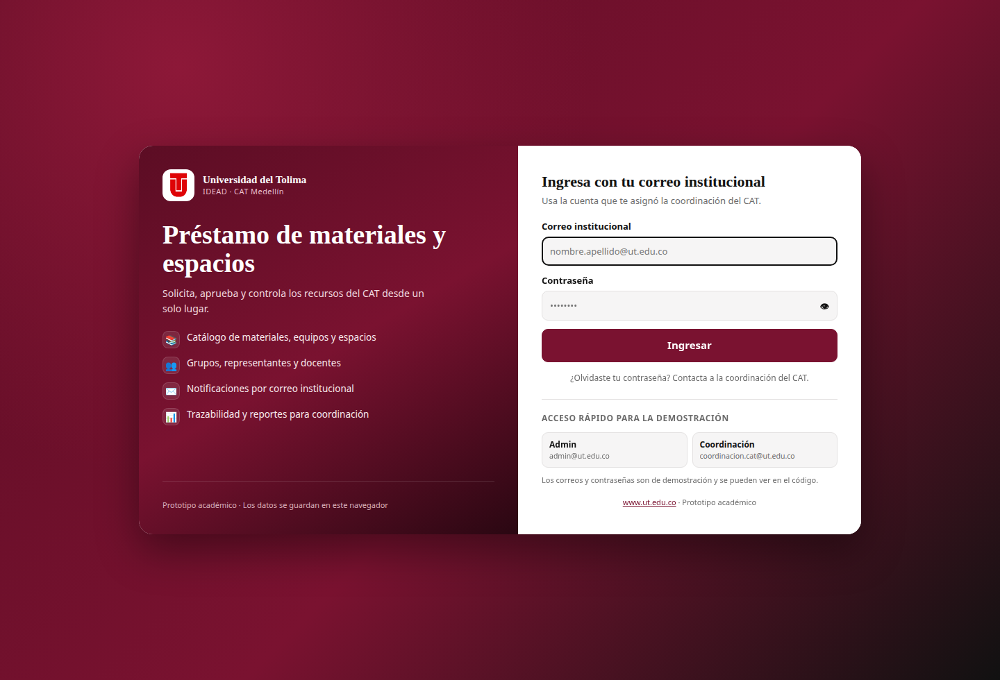
<figcaption><b>Figura 1.</b> Pantalla de ingreso. Se muestra el logosímbolo institucional, el acceso con correo y las cuentas de demostración para administrador y coordinación.</figcaption>
</figure>

<figure>
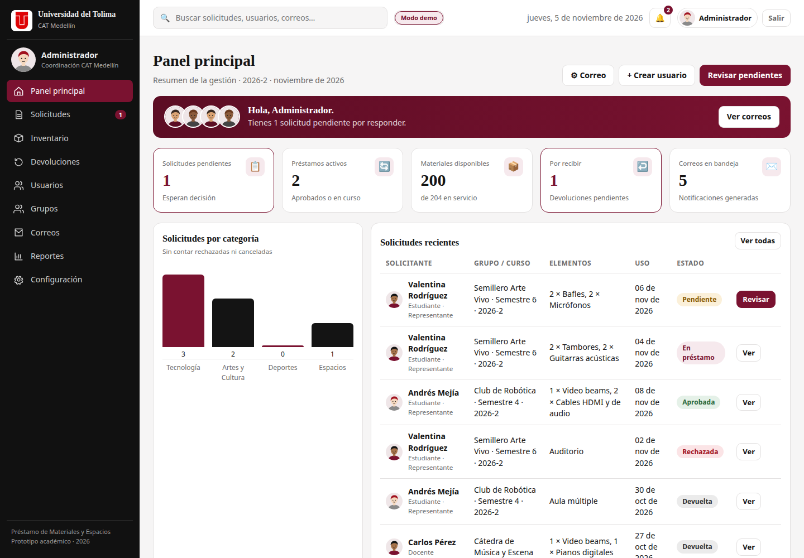
<figcaption><b>Figura 2.</b> Panel principal del administrador. Resume solicitudes pendientes, préstamos activos, materiales disponibles, devoluciones y correos, con acceso rápido a las tareas frecuentes.</figcaption>
</figure>

<figure>
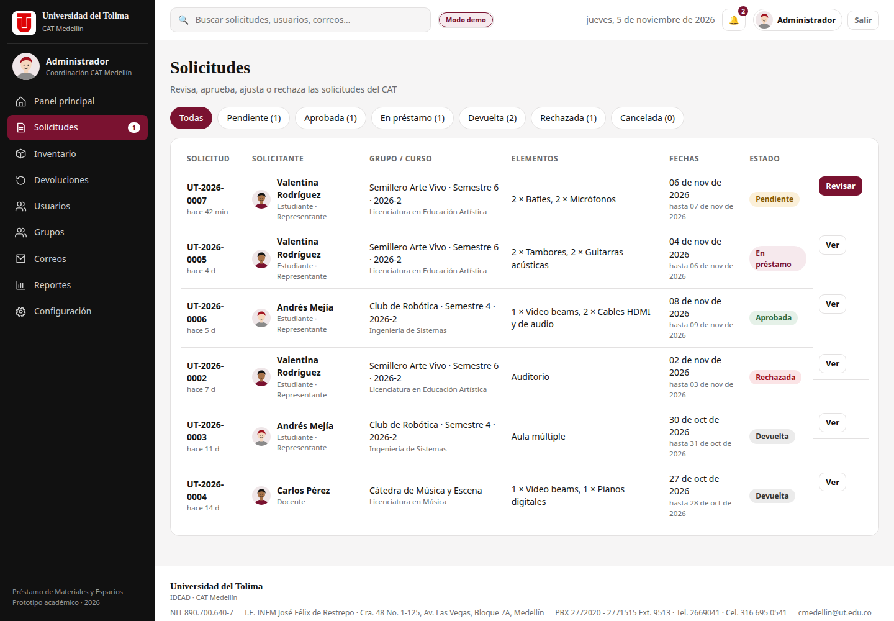
<figcaption><b>Figura 3.</b> Bandeja de solicitudes. La coordinación filtra por estado y revisa solicitante, grupo, elementos, fechas y estado antes de abrir el detalle.</figcaption>
</figure>

<figure>
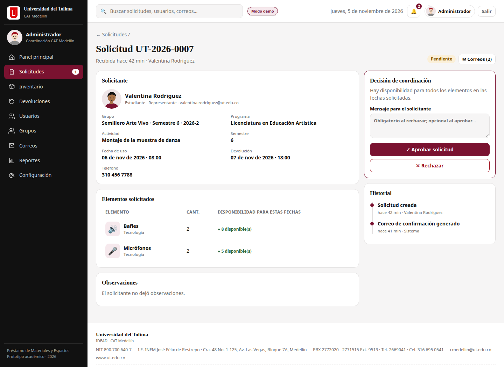
<figcaption><b>Figura 4.</b> Detalle de la solicitud. Integra datos del solicitante, disponibilidad para las fechas, decisión de coordinación e historial de acciones.</figcaption>
</figure>

<figure>
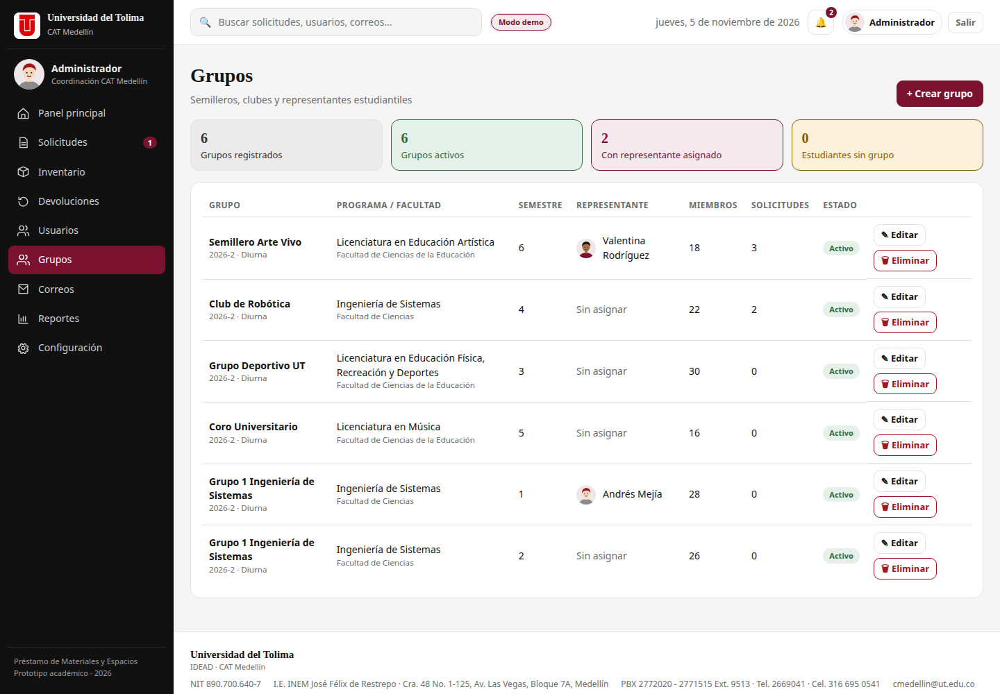
<figcaption><b>Figura 5.</b> Gestión de grupos. Se observan dos grupos con el mismo nombre en semestres distintos; cada fila permite editar o eliminar. Al eliminar se conserva el historial.</figcaption>
</figure>

<figure>
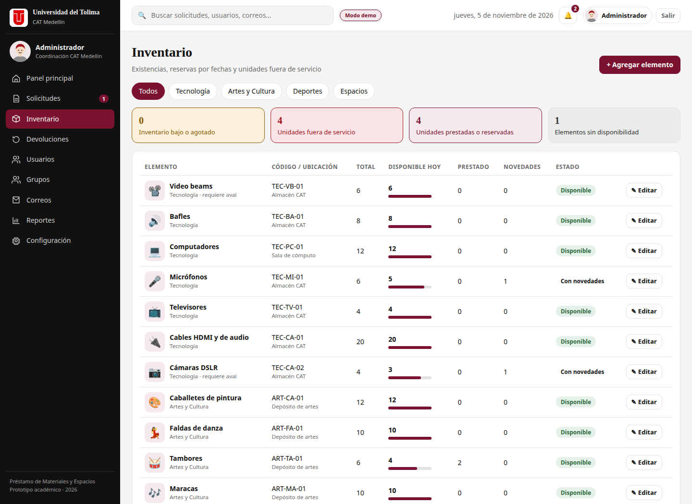
<figcaption><b>Figura 6.</b> Inventario. Muestra existencias, unidades fuera de servicio, ubicación, disponibilidad y estado de cada material o espacio.</figcaption>
</figure>

<figure>
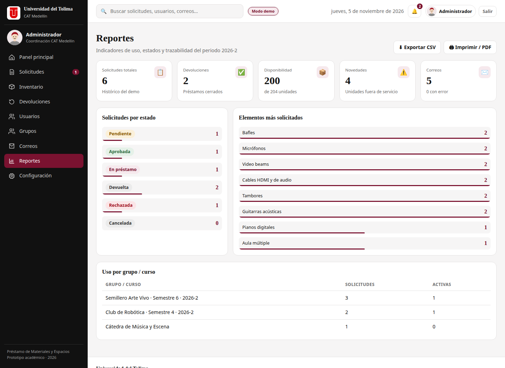
<figcaption><b>Figura 7.</b> Reportes. Indicadores del periodo, distribución por estado, elementos más solicitados y uso por grupo, con exportación CSV e impresión/PDF.</figcaption>
</figure>

<figure>
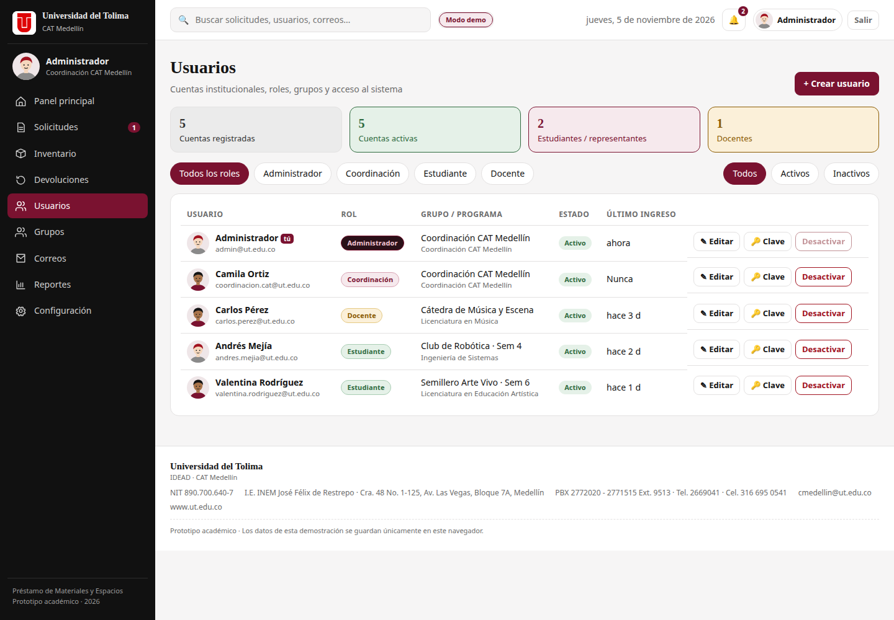
<figcaption><b>Figura 8.</b> Usuarios. El administrador consulta roles, programas, grupos y estado, y puede crear, editar o restablecer credenciales.</figcaption>
</figure>

<figure>
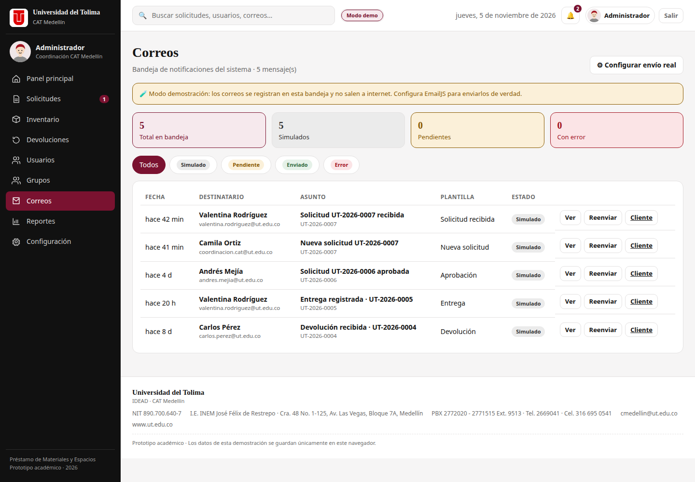
<figcaption><b>Figura 9.</b> Bandeja de correos. En modo demostración los mensajes no salen a internet; quedan registrados con su plantilla y estado.</figcaption>
</figure>

<figure>
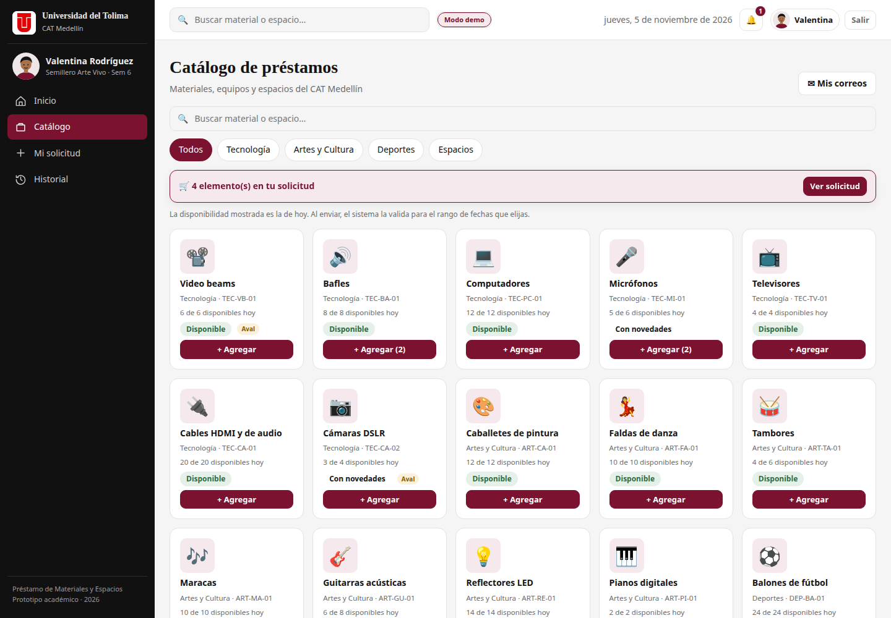
<figcaption><b>Figura 10.</b> Catálogo del estudiante. Búsqueda, categorías, disponibilidad del día y carrito de solicitud. La disponibilidad se valida de nuevo para las fechas elegidas.</figcaption>
</figure>

<figure>
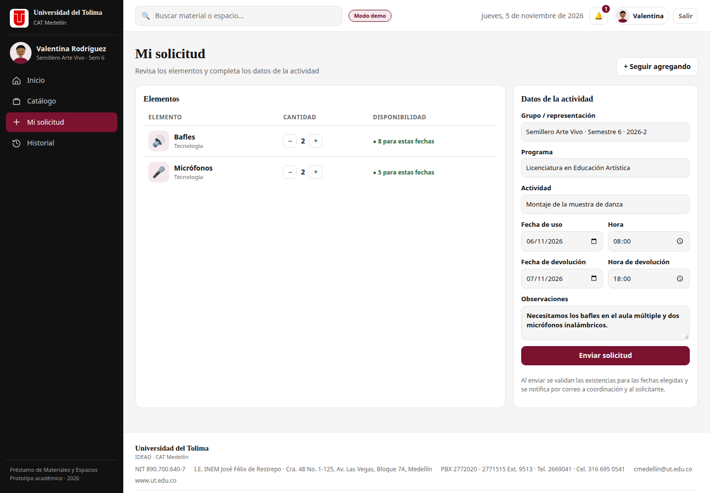
<figcaption><b>Figura 11.</b> Mi solicitud. El estudiante revisa cantidades y disponibilidad para las fechas, describe la actividad y envía la solicitud.</figcaption>
</figure>

<figure class="fig-mobile">
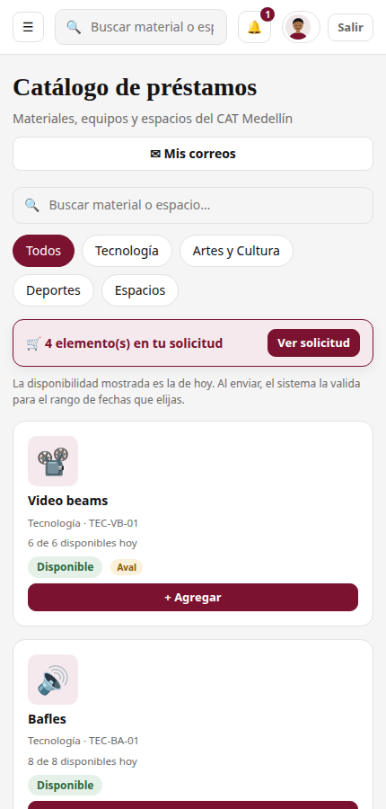
<figcaption><b>Figura 12.</b> Vista móvil del catálogo. El diseño responsive permite solicitar desde el teléfono, lo que reduce la dependencia de la atención presencial.</figcaption>
</figure>

## 11. Pruebas y resultados

Las pruebas se realizaron en el navegador, con datos de demostración y con la aplicación servida por HTTP. No se dispone de pruebas automatizadas en esta versión.

| # | Caso de prueba | Procedimiento | Resultado esperado | Resultado obtenido |
|---|---|---|---|---|
| 1 | Ingreso por rol | Iniciar sesión como administrador y como coordinación. | Cada rol ve su menú y sus acciones. | Correcto. |
| 2 | Crear grupos homónimos | Crear «Grupo 1 Ingeniería de Sistemas» en semestre 1 y en semestre 2. | Se permiten ambos y se muestran etiquetas completas. | Correcto. |
| 3 | Bloquear duplicado exacto | Repetir nombre, programa, semestre, jornada y periodo. | El sistema rechaza el duplicado. | Correcto. |
| 4 | Eliminar grupo con usuarios | Eliminar un grupo con un usuario y una solicitud asociada. | Usuario sin grupo; solicitud conserva el nombre; grupo desaparece. | Correcto. |
| 5 | Disponibilidad por fechas | Crear dos solicitudes que se cruzan y dos que no se cruzan. | Las primeras compiten; las segundas pueden usar el mismo recurso. | Correcto. |
| 6 | Entrega anticipada | Aprobar una solicitud con fecha futura y registrar la entrega hoy. | El inventario se descuenta de inmediato. | Correcto: 8 → 6 unidades. |
| 7 | Devolución | Registrar la devolución del caso anterior. | Las unidades vuelven a estar disponibles. | Correcto: 6 → 8 unidades. |
| 8 | Devolución con novedad | Registrar una unidad dañada. | Se descuenta y queda en el historial. | Correcto. |
| 9 | Correos simulados | Crear una solicitud y revisar la bandeja. | Se generan correos para solicitante y coordinación. | Correcto. |
| 10 | Caché de la PWA | Actualizar archivos y recargar. | Se carga la versión nueva y la caché queda en `v14`. | Correcto. |
| 11 | Consola del navegador | Recorrer las vistas principales. | Sin errores de JavaScript. | Correcto. |
| 12 | Diseño móvil | Abrir el catálogo en 430 px de ancho. | Navegación y tarjetas adaptadas. | Correcto. |

### 11.1 Hallazgo corregido durante el proyecto

Durante las pruebas se detectó que, si se registraba una entrega antes de la fecha de uso, el material seguía apareciendo como disponible hasta que llegara esa fecha. El problema se corrigió con `deliveredAt`, `effectiveStart()` y `effectiveEnd()`. La corrección se verificó con una prueba de regresión y quedó documentada en el README.

### 11.2 Alcance de la validación

Las pruebas confirman el comportamiento funcional del prototipo en un navegador y con datos ficticios. No sustituyen:

- Pruebas de carga con muchos usuarios.
- Pruebas de seguridad y penetración.
- Pruebas de accesibilidad con usuarios reales.
- Pruebas de concurrencia entre dispositivos.
- Pruebas automatizadas de regresión.

## 12. Resultados y discusión

### 12.1 Resultados alcanzados

El prototipo logra un flujo completo y comprensible:

- El administrador puede preparar la operación: usuarios, grupos, inventario y periodo.
- El estudiante o docente encuentra recursos y solicita con fechas concretas.
- La coordinación decide con información de disponibilidad y deja constancia.
- La entrega y la devolución actualizan el inventario.
- Las notificaciones y los correos mantienen informados a los actores.
- Los reportes permiten observar el uso del servicio.

### 12.2 Valor frente al proceso manual

| Aspecto | Proceso manual | Prototipo |
|---|---|---|
| Consulta de disponibilidad | Preguntar o revisar planillas | Cálculo por fechas y cantidades |
| Registro de la solicitud | Papel, correo o mensaje | Formulario único con estado |
| Aprobación | Informal | Decisión registrada con motivo |
| Entrega | Anotación separada | Estado e inventario actualizados |
| Devolución | Sin control uniforme | Registro con novedades |
| Notificación | Llamadas o mensajes | Campana y correos |
| Reportes | Conteo manual | Indicadores y exportación |
| Acceso | Presencial | Web y móvil, instalable |

### 12.3 Discusión

La principal fortaleza del proyecto es haber convertido un proceso disperso en un flujo verificable. La principal debilidad es que la persistencia local no permite operar institucionalmente: cada navegador tiene su propia copia y no hay sincronización. Por eso el prototipo debe entenderse como una **prueba de concepto** y como una base de interfaz para la versión con backend.

También es importante no confundir «tener una pantalla» con «resolver el proceso». Las reglas de disponibilidad, los estados, la entrega anticipada y la conservación del historial son las decisiones que realmente aportan valor y las que deben validarse con la coordinación del CAT antes de avanzar a producción.

## 13. Limitaciones y trabajo futuro

### 13.1 Limitaciones actuales

1. **Sin backend:** no hay base de datos central ni sincronización.
2. **Autenticación de demostración:** las credenciales están en el código y en `localStorage`.
3. **Datos por navegador:** cada equipo ve su propia copia.
4. **Correos simulados:** no llegan a buzones reales salvo que se configure EmailJS.
5. **Sin control de concurrencia:** dos personas podrían modificar la misma copia en equipos distintos.
6. **Auditoría local:** el historial se puede alterar desde el navegador.
7. **Accesibilidad parcial:** falta auditoría WCAG y pruebas con usuarios.
8. **Sin pruebas automatizadas:** la validación es manual.
9. **Respaldo solo de salida:** se descarga JSON, pero no se importa.
10. **Sin eliminación de usuarios:** se pueden desactivar, pero no borrar conservando historial.

### 13.2 Trabajo futuro

| Prioridad | Mejora | Beneficio |
|---|---|---|
| Alta | Migrar a Supabase/PostgreSQL con autenticación y RLS. | Datos centrales, seguridad y multiusuario. |
| Alta | Validar permisos y disponibilidad en el servidor. | Evita dobles reservas y accesos indebidos. |
| Alta | Enviar correos desde backend y programar recordatorios. | Comunicación confiable. |
| Alta | Auditoría inmutable de acciones. | Trazabilidad institucional. |
| Media | Devoluciones parciales por línea y unidad. | Mayor precisión del inventario. |
| Media | Importar respaldos y exportar reportes en Excel/PDF. | Operación y análisis. |
| Media | Auditoría de accesibilidad WCAG 2.1 AA y pruebas con lectores de pantalla. | Inclusión real. |
| Media | Pruebas automatizadas y despliegue continuo. | Menos regresiones. |
| Baja | Notificaciones push y calendario de reservas. | Mejor experiencia. |
| Baja | Firma digital y evidencias fotográficas. | Actas de entrega más robustas. |

## 14. Conclusiones

1. El préstamo de materiales y espacios del CAT Medellín es un proceso con reglas de negocio claras que puede beneficiarse de una aplicación web sencilla, siempre que se definan disponibilidad, roles, estados y trazabilidad.
2. El prototipo Préstamos UT demuestra que es posible recorrer todo el ciclo del préstamo —catálogo, solicitud, aprobación, entrega, devolución y reporte— con tecnologías web estándar y sin infraestructura costosa.
3. La gestión de grupos por semestre y periodo, la conservación del historial al eliminar un grupo y el descuento inmediato del inventario al entregar son mejoras que acercan el prototipo a la operación real.
4. La accesibilidad debe entenderse en dos planos: facilitar el acceso al servicio y cumplir criterios de accesibilidad web. El prototipo avanza en ambos, pero todavía requiere una auditoría formal y pruebas con usuarios.
5. El prototipo es adecuado para una presentación académica y para validar el diseño con la coordinación, pero no para operar con datos personales reales hasta migrar a un backend con autenticación, base de datos central y auditoría.
6. El siguiente paso recomendado no es agregar más pantallas, sino **probar el flujo con usuarios reales del CAT**, priorizar los ajustes de accesibilidad y definir las reglas institucionales de disponibilidad, devolución y sanción.

## 15. Referencias

Congreso de la República de Colombia. (2012). *Ley 1581 de 2012, por la cual se dictan disposiciones generales para la protección de datos personales*. Diario Oficial.

MDN Web Docs. (2026). *Progressive web apps (PWAs)*. Mozilla. https://developer.mozilla.org/es/docs/Web/Progressive_web_apps

MDN Web Docs. (2026). *Service Worker API*. Mozilla. https://developer.mozilla.org/es/docs/Web/API/Service_Worker_API

MDN Web Docs. (2026). *Window.localStorage*. Mozilla. https://developer.mozilla.org/es/docs/Web/API/Window/localStorage

Universidad del Tolima. (2026). *Directorio institucional: CAT Medellín*. https://administrativos.ut.edu.co/atencion-al-ciudadano/directorio.html

W3C. (2023). *Web Content Accessibility Guidelines (WCAG) 2.1*. World Wide Web Consortium. https://www.w3.org/TR/WCAG21/

W3C. (2024). *Web Content Accessibility Guidelines (WCAG) 2.2*. World Wide Web Consortium. https://www.w3.org/TR/WCAG22/

web.dev. (2026). *Learn PWA*. Google. https://web.dev/learn/pwa/

EmailJS. (2026). *EmailJS documentation*. https://www.emailjs.com/docs/

## Anexos

### Anexo A. Credenciales de demostración

| Rol | Correo | Contraseña |
|---|---|---|
| Administrador | `admin@ut.edu.co` | `admin2026` |
| Coordinación | `coordinacion.cat@ut.edu.co` | `cat2026` |

La cuenta administradora se muestra como **Administrador**, sin nombre personal. Los datos de estudiantes, docentes, solicitudes, notificaciones y correos que aparecen en las capturas son ficticios y se generaron para la presentación.

### Anexo B. Ejecución local

```bash
cd prestamos-ut-pwa-v3
python3 -m http.server 8080
```

Abrir `http://localhost:8080/`. No se debe abrir `index.html` con `file://` porque el service worker, el manifiesto y las rutas relativas requieren HTTP o HTTPS.

Si no se ven los cambios:

1. Recargar con `Ctrl + Shift + R`.
2. Abrir las herramientas del navegador → **Application → Service Workers → Unregister**.
3. **Application → Storage → Clear site data**.
4. Volver a cargar la aplicación.

### Anexo C. Estructura de la entrega

```text
prestamos-ut-pwa-v3/
├── index.html
├── manifest.webmanifest
├── sw.js
├── css/
│   ├── styles.css
│   └── demo.css
├── js/
│   ├── store.js
│   ├── email.js
│   ├── app.js
│   ├── views-requests.js
│   ├── views-admin.js
│   ├── views-student.js
│   ├── init.js
│   └── pwa.js
├── icons/
├── docs/
│   ├── INFORME-APLICACION.md
│   ├── INFORME-APLICACION.html
│   ├── INFORME-APLICACION.pdf
│   ├── INFORME-APLICACION.docx
│   ├── REQUISITOS.md
│   ├── ARQUITECTURA-Y-DATOS.md
│   └── PLAN-MAESTRO.md
└── README.md
```

### Anexo D. Glosario

| Término | Definición |
|---|---|
| **PWA** | Aplicación web progresiva: sitio web que puede instalarse y funcionar como app. |
| **Service worker** | Script del navegador que intercepta solicitudes y gestiona la caché. |
| **`localStorage`** | Almacenamiento persistente del navegador, limitado al equipo y al dominio. |
| **Disponibilidad** | Unidades de un recurso que pueden prestarse en un rango de fechas. |
| **Aval** | Autorización de un docente o dependencia para usar un recurso. |
| **Novedad** | Registro de daño, pérdida o faltante al devolver un préstamo. |
| **Historial** | Conjunto de acciones registradas sobre una solicitud. |
| **Rol** | Conjunto de permisos asignado a un tipo de usuario. |

---

*Fin del informe.*
