

Universidad del Tolima · IDEAD · CAT Medellín

<h1>Manual de usuario</h1>

Préstamos UT · Sistema de gestión de préstamos de materiales, equipos y espacios

<b>Dirigido a:</b> administración, coordinación, estudiantes y docentes

<b>Periodo de referencia:</b> 2026-2

<b>Versión del documento:</b> 1.0 · noviembre de 2026

<b>Modalidad:</b> prototipo funcional (aplicación web progresiva)

Guía paso a paso para usar la aplicación. Las capturas corresponden al prototipo funcional y utilizan datos ficticios de demostración. No se deben registrar datos personales reales en esta versión.

Contenido

<ol class="toc-list">
<li><a href="#presentacion">1. Presentación</a>00</li>
<li><a href="#antes-de-empezar">2. Antes de empezar</a>00</li>
<li><a href="#ingresar-y-cerrar-sesion">3. Ingresar y cerrar sesión</a>00</li>
<li><a href="#guia-del-administrador">4. Guía del administrador</a>00</li>
<li><a href="#guia-de-coordinacion">5. Guía de coordinación</a>00</li>
<li><a href="#guia-del-estudiante-y-del-docente">6. Guía del estudiante y del docente</a>00</li>
<li><a href="#correos-y-notificaciones">7. Correos y notificaciones</a>00</li>
<li><a href="#instalar-la-pwa">8. Instalar la PWA y usarla en el celular</a>00</li>
<li><a href="#solucion-de-problemas">9. Solución de problemas</a>00</li>
<li><a href="#buenas-practicas">10. Buenas prácticas y cierre</a>00</li>
<li><a href="#anexo-a-credenciales">Anexo A. Credenciales y flujo rápido</a>00</li>
<li><a href="#anexo-b-glosario">Anexo B. Glosario</a>00</li>
</ol>

Los enlaces del contenido permiten saltar a cada sección cuando el documento se consulta en pantalla.

## 1. Presentación

### 1.1 ¿Qué es Préstamos UT?

**Préstamos UT** es una aplicación web progresiva (PWA) creada para apoyar la gestión de préstamos de materiales, equipos y espacios del CAT Medellín de la Universidad del Tolima. En un solo lugar permite consultar el catálogo, crear solicitudes, aprobarlas o rechazarlas, registrar entregas y devoluciones, generar notificaciones y consultar reportes.

La aplicación está pensada para que cada persona realice solamente las tareas que le corresponden. El administrador organiza las cuentas, los grupos y el inventario; la coordinación atiende las solicitudes y controla el préstamo; los estudiantes y docentes consultan la disponibilidad y solicitan los recursos.

> **Importante:** esta versión es un **prototipo académico y funcional**. Los datos se guardan únicamente en el navegador donde se usa la aplicación y los correos se registran en una bandeja interna. No es todavía un sistema institucional de producción.

### 1.2 ¿A quién está dirigido este manual?

Este manual está dirigido a cuatro tipos de usuario:

- **Administración:** crea y mantiene usuarios, grupos, inventario y configuración general.
- **Coordinación del CAT:** revisa solicitudes, decide, registra entregas y devoluciones y consulta reportes.
- **Estudiantes:** solicitan recursos a nombre de su grupo o representación estudiantil.
- **Docentes:** solicitan recursos para un curso o cátedra y pueden avalar actividades.

Cada rol ve un menú diferente. Si una opción no aparece en la pantalla, significa que el rol de la cuenta no tiene permiso para usarla.

### 1.3 Alcance de esta versión

La versión que se describe en este manual permite:

- Ingresar con correo institucional y contraseña.
- Gestionar usuarios con roles de administrador, coordinación, estudiante y docente.
- Crear, editar y eliminar grupos con programa, facultad, semestre, jornada y periodo.
- Administrar un catálogo de materiales, equipos y espacios.
- Consultar disponibilidad por rangos de fechas y horas.
- Crear solicitudes con varios elementos, cantidades, actividad, fechas y observaciones.
- Aprobar, rechazar o ajustar solicitudes desde la coordinación.
- Registrar la entrega y la devolución, incluidas novedades por daño o pérdida.
- Generar notificaciones internas y correos simulados.
- Consultar reportes, exportar un CSV e imprimir o guardar en PDF.
- Instalar la aplicación en el celular o en el computador cuando el navegador lo permita.

### 1.4 Requisitos para usar la aplicación

Para usar Préstamos UT se necesita:

1. Un navegador actualizado: Google Chrome, Microsoft Edge, Mozilla Firefox, Safari u otro navegador moderno.
2. Conexión a internet la primera vez que se abre la aplicación, para descargar los archivos y el catálogo.
3. Un correo institucional terminado en `@ut.edu.co` para las cuentas creadas desde el sistema.
4. JavaScript activado en el navegador.
5. Para instalar la PWA, acceder mediante `https://` o desde `http://localhost`. En una dirección `file://` la instalación y el service worker no funcionan correctamente.

> **Consejo:** para una presentación, abre la aplicación antes de empezar y deja el navegador en una pestaña independiente. Así evitas esperas por la carga inicial y puedes mostrar el flujo sin interrupciones.

## 2. Antes de empezar

### 2.1 Roles y permisos

La aplicación distingue cuatro roles. El menú y las acciones disponibles cambian según el rol de la cuenta que inicia sesión.

| Rol | Para qué sirve | Opciones principales |
|---|---|---|
| **Administrador** | Organiza el sistema y las cuentas. | Panel, Solicitudes, Inventario, Devoluciones, Usuarios, Grupos, Correos, Reportes y Configuración. |
| **Coordinación** | Atiende el ciclo operativo del préstamo. | Panel, Solicitudes, Inventario, Devoluciones, Correos y Reportes. |
| **Estudiante** | Solicita recursos para su grupo o representación. | Inicio, Catálogo, Mi solicitud e Historial. |
| **Docente** | Solicita recursos para un curso o cátedra. | Inicio, Catálogo, Mi solicitud e Historial. |

Además, todos los usuarios pueden abrir **Mi perfil** desde el botón con su nombre, en la parte inferior de la barra lateral, y cerrar sesión con el botón **Salir**.

### 2.2 Estados de una solicitud

Cada solicitud recorre un ciclo de vida. El estado se muestra con una etiqueta de color en las tablas y en el detalle.

| Estado | Significado | Quién lo genera |
|---|---|---|
| **Pendiente** | La solicitud fue enviada y espera la decisión de coordinación. | El solicitante al enviarla. |
| **Aprobada** | La coordinación autorizó el préstamo y las existencias quedan reservadas para las fechas. | Coordinación al aprobar. |
| **En préstamo** | El material fue entregado físicamente y ya está descontado del inventario. | Coordinación al registrar la entrega. |
| **Devuelta** | El material regresó al CAT y el préstamo quedó cerrado. | Coordinación al registrar la devolución. |
| **Rechazada** | La solicitud no fue autorizada; debe incluir un motivo para el solicitante. | Coordinación al rechazar. |
| **Cancelada** | El solicitante decidió retirar la solicitud antes de que fuera atendida. | El solicitante, mientras esté pendiente. |

> **Importante:** una solicitud **aprobada** todavía no descuenta el inventario disponible. El descuento ocurre cuando la coordinación registra la **entrega**. Si la entrega se hace antes de la fecha de uso, el material se descuenta desde ese momento, aunque la actividad sea en días posteriores.

### 2.3 Cómo se calcula la disponibilidad

La disponibilidad no depende solo de la cantidad total de un elemento. El sistema compara las **fechas y horas de uso** de las solicitudes activas:

- Una solicitud **aprobada** o **en préstamo** ocupa inventario durante su rango de fechas.
- Dos solicitudes que no se cruzan en el tiempo pueden usar el mismo material.
- Dos solicitudes que se cruzan compiten por las existencias disponibles.
- Las unidades **fuera de servicio** se restan de la cantidad total.
- Cuando una entrega se registra antes de la fecha prevista, el sistema descuenta el material desde el momento real de la entrega.
- Mientras un préstamo no se devuelva, sigue ocupando inventario aunque la fecha prevista ya haya pasado.

La fórmula que se aplica es, en términos sencillos:

**Disponible para un rango = total − unidades fuera de servicio − unidades comprometidas en ese rango**

### 2.4 Recomendaciones para una demostración

Si vas a presentar la aplicación:

1. Abre la aplicación y verifica que las cuentas de administrador y coordinación funcionen.
2. Crea un grupo y un usuario de estudiante antes de la presentación, o hazlo en vivo si el tiempo lo permite.
3. Ten a mano las credenciales y una actividad de ejemplo, por ejemplo «muestra cultural» o «torneo interno».
4. Usa fechas cercanas y distintas para mostrar que la disponibilidad cambia según el rango.
5. Al terminar, revisa la campana de notificaciones, la bandeja de correos y el historial de la solicitud.

## 3. Ingresar y cerrar sesión

### 3.1 Abrir la aplicación

Abre la dirección que te entregue la coordinación del CAT. Si estás ejecutando la aplicación localmente, usa la dirección del servidor, por ejemplo `http://localhost:8080/`. No abras el archivo `index.html` directamente con `file://`, porque la PWA y el service worker necesitan HTTP o HTTPS.

Al cargar, verás la pantalla de ingreso con el logosímbolo de la Universidad del Tolima, el formulario de correo y contraseña y el bloque de **acceso rápido para la demostración**.

<figure>
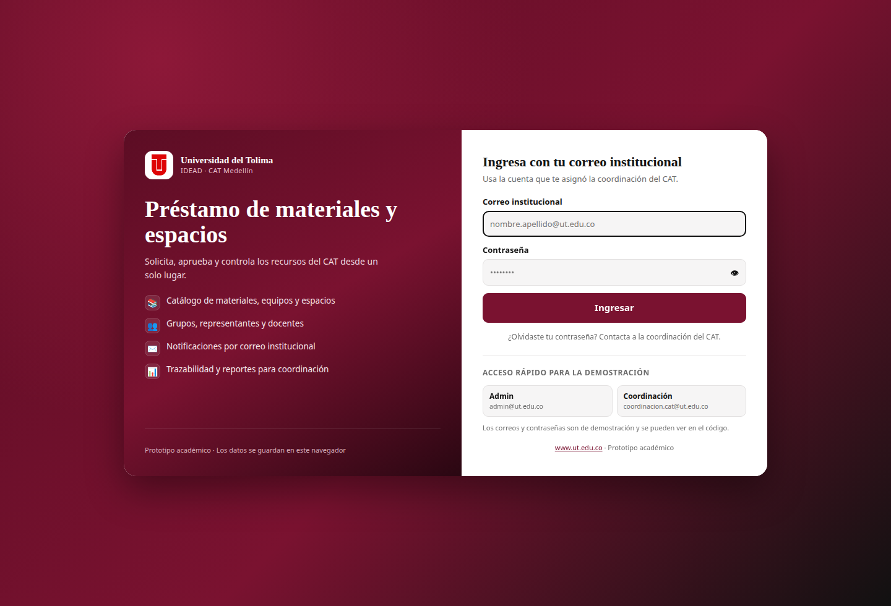
<figcaption><b>Figura 1.</b> Pantalla de ingreso. A la izquierda se presenta la aplicación; a la derecha se escribe el correo institucional y la contraseña. Los botones inferiores permiten entrar rápidamente con las cuentas de demostración.</figcaption>
</figure>

### 3.2 Ingresar con correo y contraseña

1. Escribe tu **correo institucional** en el primer campo. Debe ser el correo con el que la coordinación creó tu cuenta.
2. Escribe tu **contraseña** en el segundo campo. Puedes usar el botón del ojo para mostrar u ocultar lo que escribiste.
3. Pulsa **Ingresar**.
4. Si los datos son correctos, la aplicación abre el panel correspondiente a tu rol.

Si el correo o la contraseña no coinciden, aparecerá el mensaje **«Correo o contraseña incorrectos»**. Si la cuenta existe pero fue desactivada, el mensaje indicará que debes contactar al administrador del sistema.

### 3.3 Acceso rápido de demostración

En la parte inferior de la pantalla de ingreso hay dos botones de acceso rápido:

- **Admin:** ingresa con la cuenta `admin@ut.edu.co`.
- **Coordinación:** ingresa con la cuenta `coordinacion.cat@ut.edu.co`.

Estos botones son una ayuda para la demostración y no reemplazan el ingreso normal. Las contraseñas de demostración están documentadas en el Anexo A y son visibles en el código del prototipo.

### 3.4 Si olvidaste la contraseña

Esta versión no tiene recuperación automática de contraseña por correo. Si no puedes ingresar:

1. Pide al **administrador** que restablezca tu contraseña. La coordinación no puede gestionar cuentas de usuario.
2. La persona administradora debe abrir **Usuarios**, ubicar tu cuenta y pulsar **Clave**.
3. El sistema genera una contraseña temporal y un correo de restablecimiento.
4. Consulta la bandeja de correos o el correo que te comparta el administrador e ingresa con la nueva contraseña.

### 3.5 Cerrar sesión y editar el perfil

- Para cerrar sesión, pulsa **Salir** en la parte inferior de la barra lateral.
- Para consultar o editar tus datos, pulsa el botón con tu nombre, junto a **Salir**. Se abrirá **Mi perfil**.
- En **Mi perfil** puedes cambiar tu nombre, tu teléfono y tu contraseña. El correo institucional solo lo puede modificar la administración.

> **Consejo:** si usas un computador compartido, cierra sesión al terminar. La sesión se guarda mientras la pestaña permanezca abierta, pero los datos de la demostración quedan en el navegador.

## 4. Guía del administrador

El administrador es el rol con más opciones. Su tarea principal es preparar el sistema para que la coordinación y los solicitantes puedan trabajar: crear grupos, crear usuarios, mantener el inventario y revisar la configuración.

### 4.1 Conocer el panel principal

Al ingresar como administrador se abre el **Panel principal**. Allí se resume el estado general:

- Solicitudes pendientes.
- Préstamos activos.
- Materiales disponibles.
- Devoluciones por recibir.
- Correos en la bandeja.
- Solicitudes por categoría.
- Solicitudes recientes con acceso directo al detalle.

En la parte superior también hay accesos rápidos para configurar el correo, crear un usuario y revisar las solicitudes pendientes.

<figure>
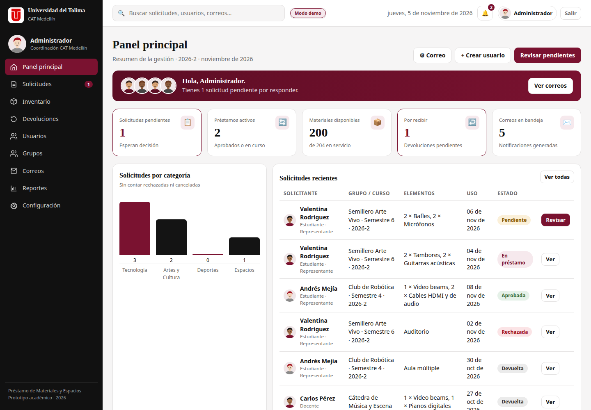
<figcaption><b>Figura 2.</b> Panel principal del administrador. Los indicadores permiten detectar pendientes y revisar la actividad reciente sin entrar a cada módulo.</figcaption>
</figure>

### 4.2 Crear y organizar grupos

Los grupos permiten identificar a los estudiantes que solicitan recursos: semilleros, clubes, representaciones estudiantiles o grupos de curso. Un estudiante debe tener un grupo asignado para poder enviar solicitudes.

#### Crear un grupo

1. En la barra lateral, abre **Grupos**.
2. Pulsa **+ Crear grupo**.
3. Completa los datos:
   - **Nombre del grupo:** por ejemplo, «Semillero Arte Vivo».
   - **Programa:** programa académico al que pertenece.
   - **Facultad / dependencia:** opcional, pero recomendable.
   - **Semestre:** número entre 1 y 12.
   - **Miembros:** cantidad aproximada de integrantes.
   - **Jornada:** Diurna, Nocturna o Mixta.
   - **Periodo:** por ejemplo, `2026-2`.
   - **Representante:** estudiante activo que actuará como contacto. Es opcional.
   - **Grupo activo:** deja la casilla marcada para que aparezca en los selectores.
4. Pulsa **Guardar**.

Al asignar un representante, su cuenta queda vinculada al grupo y hereda el programa y el semestre del grupo. Si el representante estaba asignado a otro grupo, se actualiza la relación.

#### Repetir el nombre de un grupo

El sistema permite que dos grupos tengan el mismo nombre cuando cambian el programa, el semestre, la jornada o el periodo. Por ejemplo, puede existir «Grupo 1» en el semestre 2 de la jornada diurna y «Grupo 1» en el semestre 4 de la jornada nocturna.

Solo se bloquea el duplicado exacto: mismo nombre, mismo programa, mismo semestre, misma jornada y mismo periodo. Si aparece el mensaje de duplicado, cambia el semestre, la jornada o el periodo para diferenciar el grupo.

<figure>
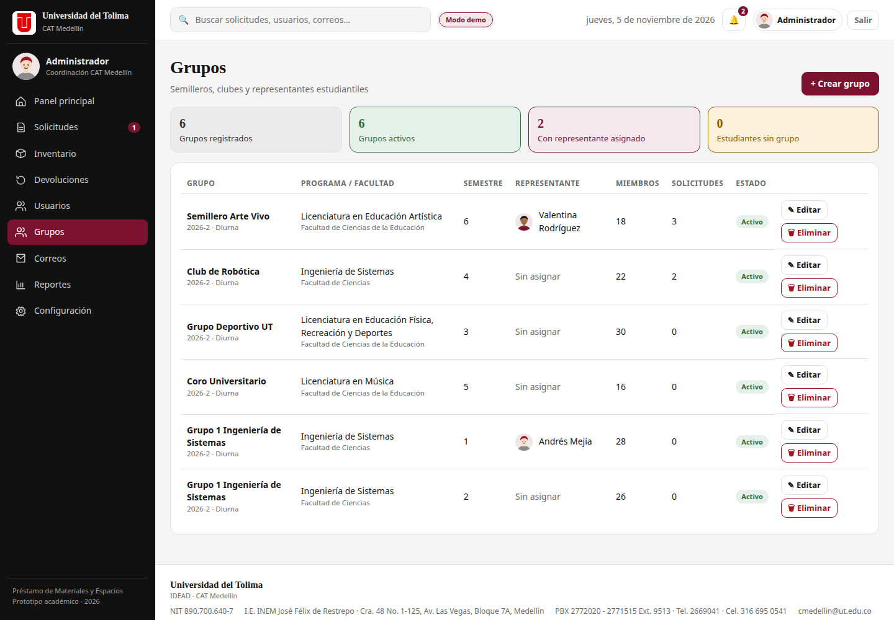
<figcaption><b>Figura 3.</b> Gestión de grupos. Cada fila muestra el nombre, el periodo, la jornada, el programa, el semestre, el representante y el número de solicitudes. Los botones permiten editar o eliminar.</figcaption>
</figure>

#### Editar o eliminar un grupo

- Para **editar**, pulsa **✎ Editar** en la fila del grupo, modifica los datos y guarda.
- Para **eliminar**, pulsa **🗑 Eliminar** y confirma la acción.

Al eliminar un grupo:

- Los usuarios vinculados quedan **sin grupo**. Deberás asignarles uno nuevo antes de que puedan volver a solicitar.
- Las solicitudes históricas **conservan el nombre completo del grupo** con el que fueron creadas.
- La acción no se puede deshacer.

> **Importante:** antes de eliminar un grupo, revisa cuántos usuarios y solicitudes están asociados. El mensaje de confirmación indica cuántos registros se verán afectados.

### 4.3 Crear usuarios y enviar invitaciones

Solo el administrador puede crear usuarios. El sistema valida que el correo termine en `@ut.edu.co` y genera una contraseña temporal.

#### Crear una cuenta

1. Abre **Usuarios** en la barra lateral.
2. Pulsa **+ Crear usuario**.
3. Completa el formulario:
   - **Nombre completo.**
   - **Correo institucional:** por ejemplo, `nombre.apellido@ut.edu.co`.
   - **Documento y teléfono:** opcionales.
   - **Rol:** Estudiante, Docente, Coordinación o Administrador.
   - **Programa / dependencia.**
   - **Grupo y semestre:** solo para estudiantes. El grupo es obligatorio.
   - **Curso / cátedra:** solo para docentes.
   - **Contraseña temporal:** se genera automáticamente; puedes cambiarla o generar otra con el botón del dado.
   - **Cuenta activa:** deja la casilla marcada para permitir el ingreso.
4. Pulsa **Crear y enviar invitación**.

Si el rol es **Estudiante**, primero debe existir al menos un grupo activo. Si aún no hay grupos, crea uno en **Grupos** y vuelve al formulario.

Después de guardar, el sistema abre el correo de invitación con el correo institucional y la contraseña temporal. Ese correo queda en la bandeja de **Correos** y, si el envío real está configurado, también se intenta enviar al buzón del usuario.

<figure>
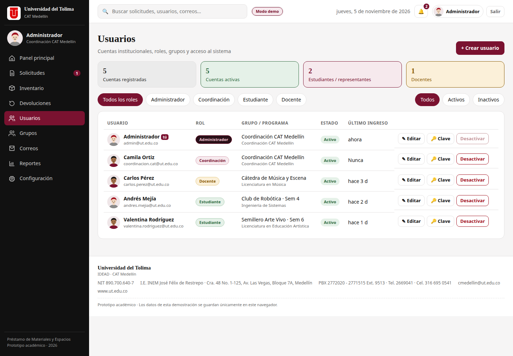
<figcaption><b>Figura 4.</b> Gestión de usuarios. Desde esta tabla se crean cuentas, se editan datos, se restablece la contraseña y se activan o desactivan usuarios.</figcaption>
</figure>

#### Editar, desactivar o restablecer una cuenta

- **Editar:** pulsa **✎ Editar**. Si dejas la contraseña en blanco, se conserva la actual. No puedes cambiar tu propio rol ni desactivar tu propia cuenta desde este formulario.
- **Desactivar:** pulsa **Desactivar**. El usuario no podrá ingresar, pero sus solicitudes y su historial se conservan. Si era representante de un grupo, el grupo queda sin representante.
- **Activar:** vuelve a pulsar el botón cuando la cuenta esté inactiva.
- **Restablecer contraseña:** pulsa **Clave**. Se genera una contraseña temporal y un correo de restablecimiento.

> **Consejo:** durante la demostración, crea un usuario de estudiante y muestra la invitación en **Correos**. Luego cierra sesión e ingresa con esa cuenta para explicar el flujo completo.

### 4.4 Revisar la bandeja de correos

La opción **Correos** muestra todos los mensajes generados por el sistema: invitaciones, solicitudes recibidas, nuevas solicitudes, aprobaciones, rechazos, ajustes, entregas, devoluciones, cancelaciones, restablecimientos y pruebas.

Cada fila indica:

- Fecha del mensaje.
- Destinatario.
- Asunto.
- Plantilla utilizada.
- Estado: **Simulado**, **Pendiente**, **Enviado** o **Error**.

Puedes abrir un correo con **Ver**, reenviarlo con **Reenviar** o abrir un enlace `mailto:` con **Cliente**. En modo demostración los correos no salen a internet: quedan registrados en la bandeja y en **Mis correos** del usuario.

<figure>
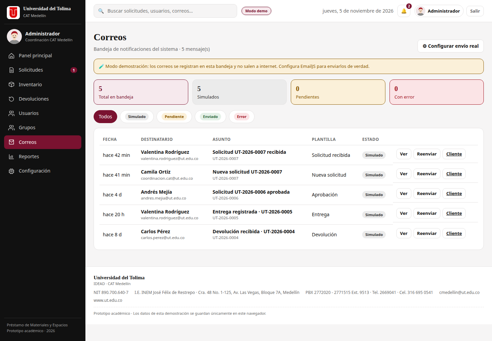
<figcaption><b>Figura 5.</b> Bandeja de correos. El estado «Simulado» confirma que el mensaje no se envió a un buzón real. Si configuras EmailJS, los envíos correctos aparecen como «Enviado».</figcaption>
</figure>

### 4.5 Administrar el inventario

La opción **Inventario** contiene los materiales, equipos y espacios disponibles. Desde allí puedes consultar existencias, disponibilidad, unidades fuera de servicio y el estado de cada recurso.

#### Agregar un elemento

1. Abre **Inventario**.
2. Pulsa **+ Agregar elemento**.
3. Completa:
   - **Nombre:** por ejemplo, «Trípodes».
   - **Categoría:** Tecnología, Artes y Cultura, Deportes o Espacios.
   - **Icono:** un emoji representativo.
   - **Código:** identificador interno, por ejemplo `TEC-TR-01`.
   - **Ubicación:** almacén, sala o zona.
   - **Cantidad total.**
   - **Fuera de servicio:** unidades dañadas o no disponibles.
   - **Requiere aval para estudiantes:** marca esta casilla si el elemento necesita autorización docente o de dirección.
4. Pulsa **Guardar**.

#### Editar existencias

Pulsa **✎ Editar** en la fila del elemento. El sistema no permite dejar el inventario por debajo de las unidades que están prestadas o reservadas. Si intentas reducirlo, aparecerá una advertencia.

El listado muestra:

- Total de unidades.
- Disponibilidad de hoy.
- Unidades prestadas o reservadas.
- Unidades con novedades.
- Estado: Disponible, Inventario bajo, Agotado, Reservado o Con novedades.

#### Eliminar un elemento

1. Abre **Inventario**.
2. Ubica el elemento y pulsa **🗑 Eliminar**.
3. Confirma la acción.

El sistema no permite eliminar un elemento si tiene solicitudes **pendientes, aprobadas o en préstamo**; primero deben cerrarse o rechazarse. Al eliminarlo, deja de aparecer en el inventario y en el catálogo, pero las solicitudes históricas conservan su nombre y su detalle. La acción no se puede deshacer desde la interfaz.

> **Consejo:** si solo quieres retirarlo temporalmente, edita la cantidad total a 0 en lugar de eliminarlo. Así el elemento sigue en el inventario, pero sin disponibilidad.

<figure class="fig-inv">
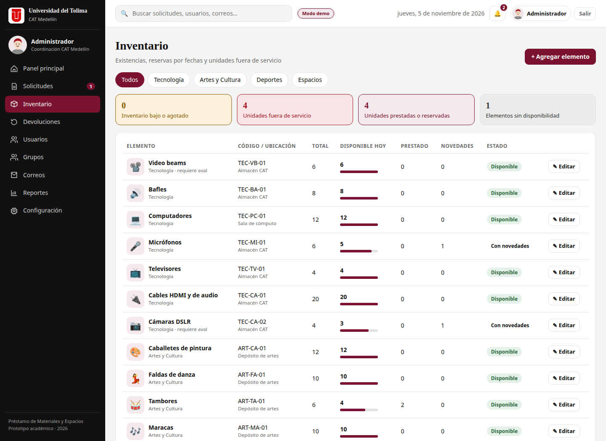
<figcaption><b>Figura 6.</b> Inventario. La barra de disponibilidad y las etiquetas de estado ayudan a detectar recursos agotados o con novedades.</figcaption>
</figure>

### 4.6 Configurar el periodo, el respaldo y el reinicio

La opción **Configuración** está disponible solo para el administrador. Allí puedes:

- **Cambiar el periodo académico y el nombre del CAT.** Se usan en la cabecera y en algunas comunicaciones.
- **Configurar el correo real.** Abre el formulario de EmailJS.
- **Descargar un respaldo.** Genera un archivo JSON con usuarios, grupos, inventario, solicitudes, notificaciones, correos y configuración.
- **Abrir el guion de la presentación.** Muestra un recorrido rápido de los pasos recomendados.
- **Restablecer la demostración.** Borra los cambios y vuelve al estado inicial. Esta acción no se puede deshacer.

> **Importante:** el respaldo es un archivo local. Guárdalo en un lugar seguro si necesitas conservar los datos de una demostración. El reinicio elimina todo lo creado en ese navegador.

## 5. Guía de coordinación

La coordinación es responsable de atender las solicitudes y de controlar el ciclo físico del préstamo: aprobar, entregar y recibir. Su menú incluye Panel, Solicitudes, Inventario, Devoluciones, Correos y Reportes.

### 5.1 Revisar las solicitudes

1. Abre **Solicitudes** en la barra lateral.
2. Usa los filtros para ver **Todas**, **Pendiente**, **Aprobada**, **En préstamo**, **Devuelta**, **Rechazada** o **Cancelada**.
3. Puedes buscar por número de solicitud, solicitante, correo, grupo, actividad o elemento.
4. Pulsa **Revisar** en una solicitud pendiente o **Ver** en una solicitud ya atendida.

La tabla muestra el número de solicitud, el tiempo transcurrido desde su creación, el solicitante, el grupo o curso, los elementos, las fechas y el estado.

<figure>
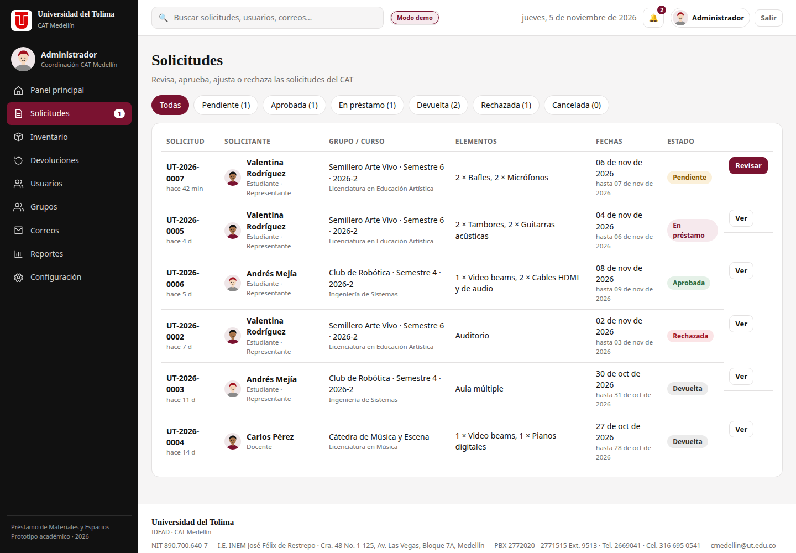
<figcaption><b>Figura 7.</b> Bandeja de solicitudes. Los filtros y el buscador permiten localizar rápidamente una solicitud y priorizar las que están pendientes.</figcaption>
</figure>

### 5.2 Analizar el detalle de la solicitud

El detalle reúne toda la información necesaria para decidir:

- Datos del solicitante: nombre, rol, correo, grupo o curso, programa y teléfono.
- Actividad y observaciones.
- Fechas y horas de uso y devolución.
- Elementos solicitados, cantidades y disponibilidad para esas fechas.
- Aval, si el elemento lo requiere.
- Historial de acciones con fecha y responsable.
- Correos asociados a la solicitud.

Si algún elemento no tiene disponibilidad suficiente, el sistema lo señala en rojo y ofrece la opción de **ajustar** la solicitud a la disponibilidad real.

<figure>
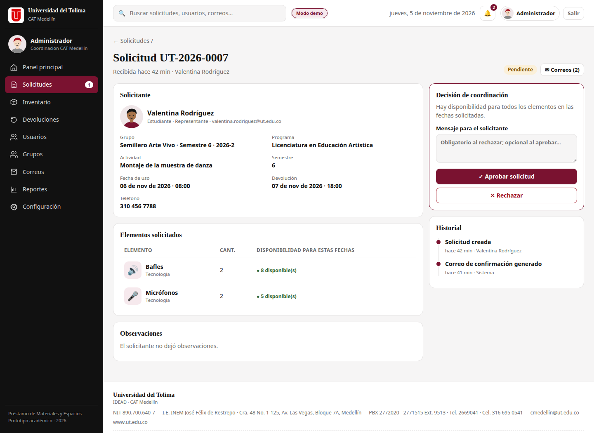
<figcaption><b>Figura 8.</b> Detalle de la solicitud. La columna derecha concentra la decisión y el historial; la izquierda muestra el contexto y los elementos solicitados.</figcaption>
</figure>

### 5.3 Aprobar, rechazar o ajustar

#### Aprobar

1. Verifica que todos los elementos tengan disponibilidad suficiente para las fechas.
2. Escribe un mensaje para el solicitante si lo deseas. Es opcional al aprobar.
3. Pulsa **✓ Aprobar solicitud**.

La solicitud pasa a **Aprobada**. Las existencias quedan reservadas para ese rango de fechas y se genera una notificación y un correo para el solicitante.

#### Rechazar

1. Escribe el **motivo del rechazo**. Es obligatorio.
2. Pulsa **✕ Rechazar**.

La solicitud pasa a **Rechazada**. El motivo queda en el historial y se envía al solicitante. Procura escribir un motivo claro y respetuoso.

#### Ajustar a la disponibilidad

Si no hay suficientes unidades, pulsa **✎ Ajustar a disponibilidad**. El sistema reduce las cantidades al máximo disponible para las fechas solicitadas y elimina los elementos que queden en cero. La solicitud sigue pendiente y el solicitante recibe una notificación con el ajuste.

Si después del ajuste no queda ningún elemento, lo recomendable es rechazar la solicitud con un motivo.

> **Importante:** la aprobación no descuenta el inventario. El descuento se produce al registrar la entrega. Si el solicitante no recoge el material, la solicitud puede quedar aprobada y reservada, pero no aparecerá como préstamo activo hasta la entrega.

### 5.4 Registrar la entrega

La entrega se registra cuando el solicitante recoge físicamente el material.

1. Abre el detalle de la solicitud aprobada.
2. Verifica con el solicitante que los elementos y las cantidades coinciden.
3. Pulsa **📦 Registrar entrega**.
4. La solicitud pasa a **En préstamo** y el inventario se descuenta de inmediato.
5. El solicitante recibe una notificación y un correo con la fecha prevista de devolución.

También puedes registrar la entrega desde **Devoluciones**, en la fila de una solicitud aprobada.

> **Importante:** la entrega se registra en el momento en que pulsas el botón, aunque la fecha de uso sea futura. El material ya está físicamente fuera del CAT y por eso se descuenta del inventario. Para probar este comportamiento, observa cómo baja la disponibilidad y cómo se restaura al registrar la devolución.

### 5.5 Registrar la devolución

1. Abre el detalle de una solicitud **En préstamo** o entra a **Devoluciones**.
2. Pulsa **↩ Registrar devolución**.
3. En la ventana de devolución, para cada elemento indica:
   - **Devuelto bien:** unidades que regresan en buen estado.
   - **Con daño:** unidades que regresan dañadas.
4. Si una unidad no se devuelve, deja la diferencia entre lo solicitado, lo devuelto bien y lo dañado. El sistema la registrará como **No devuelto**.
5. Escribe una observación si hay novedades.
6. Pulsa **Confirmar devolución**.

Al confirmar:

- La solicitud pasa a **Devuelta**.
- Las unidades devueltas en buen estado vuelven a estar disponibles.
- Las unidades dañadas o no devueltas se suman a las unidades fuera de servicio del inventario.
- Se crea una **novedad** en la solicitud y se envía un correo al solicitante.
- El historial conserva el nombre de quien recibió la devolución y la observación.

> **Consejo:** revisa el estado físico del material antes de confirmar. Si detectas un daño, regístralo en el momento para que el inventario y el historial queden actualizados.

### 5.6 Consultar reportes y exportar

La opción **Reportes** presenta una visión general del periodo:

- Solicitudes totales.
- Devoluciones cerradas.
- Disponibilidad del inventario.
- Unidades fuera de servicio.
- Correos generados y correos con error.
- Solicitudes por estado.
- Elementos más solicitados.
- Uso por grupo o curso.

Desde esta pantalla puedes:

- **Exportar CSV:** descarga un archivo con el detalle de las solicitudes, compatible con Excel y otras hojas de cálculo.
- **Imprimir / PDF:** abre el diálogo de impresión del navegador. Elige «Guardar como PDF» para conservar el reporte.

<figure>
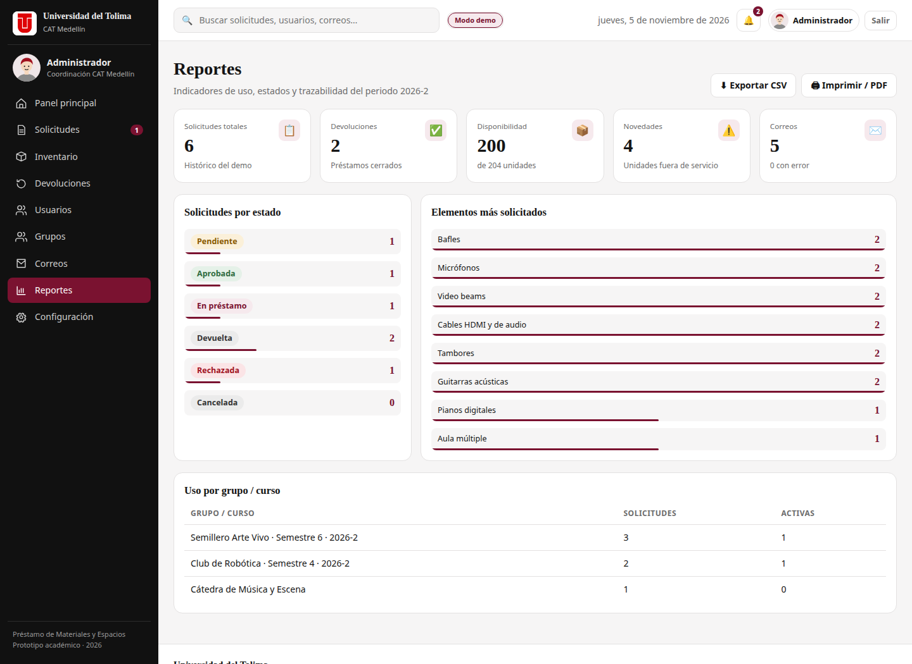
<figcaption><b>Figura 9.</b> Reportes. Los indicadores y gráficos se actualizan con las solicitudes registradas en el navegador. La exportación CSV y la impresión facilitan la entrega de evidencias.</figcaption>
</figure>

## 6. Guía del estudiante y del docente

Estudiantes y docentes comparten el mismo menú: **Inicio**, **Catálogo**, **Mi solicitud** e **Historial**. La diferencia principal es que el estudiante solicita a nombre de un grupo y el docente a nombre de un curso o cátedra.

### 6.1 Inicio del estudiante

Al ingresar, verás un saludo, tu rol y tu grupo o curso. La pantalla de inicio resume:

- Solicitudes activas.
- Solicitudes pendientes.
- Materiales por devolver.
- Materiales disponibles en el catálogo.
- Acceso rápido para solicitar material.
- Aviso de la devolución más próxima, si tienes un préstamo en curso.

### 6.2 Explorar el catálogo

1. Abre **Catálogo**.
2. Usa el buscador para encontrar un material o espacio por nombre, código o categoría.
3. Filtra por **Tecnología**, **Artes y Cultura**, **Deportes** o **Espacios**.
4. Revisa la disponibilidad de hoy y el estado de cada recurso.
5. Pulsa **+ Agregar** para sumar una unidad a tu solicitud. Puedes agregar varias unidades del mismo elemento.

La disponibilidad que se muestra en el catálogo es la del día actual. Al enviar la solicitud, el sistema vuelve a validar la disponibilidad para las fechas y horas que elijas.

<figure>
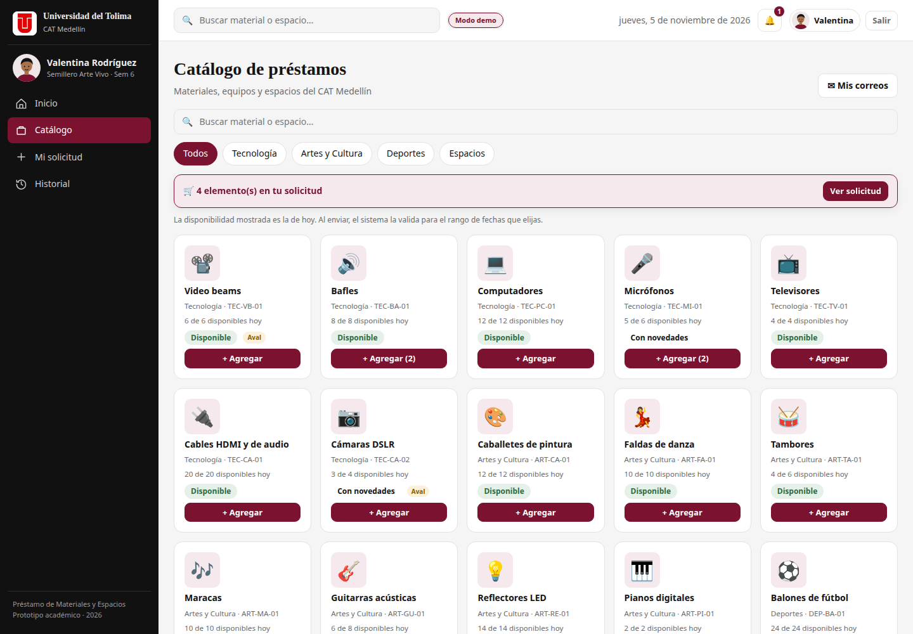
<figcaption><b>Figura 10.</b> Catálogo del estudiante. Cada tarjeta muestra el elemento, la categoría, el código, la disponibilidad del día y el estado. El botón «+ Agregar» lo lleva al carrito de la solicitud.</figcaption>
</figure>

### 6.3 Preparar «Mi solicitud»

Cuando tengas elementos en el carrito, abre **Mi solicitud** o pulsa **Ver solicitud** en la barra del catálogo.

1. Revisa los elementos y ajusta las cantidades con los botones **−** y **+**.
2. Selecciona la **fecha de uso** y la **hora** de inicio.
3. Selecciona la **fecha de devolución** y la **hora** de devolución. La devolución debe ser posterior al uso.
4. Escribe la **actividad** o motivo del préstamo. Es obligatorio.
5. Si eres estudiante y algún elemento requiere aval, escribe el **nombre o dependencia que avala**.
6. Agrega observaciones si necesitas explicar el montaje o alguna necesidad especial.
7. Revisa la columna de disponibilidad para las fechas elegidas.
8. Pulsa **Enviar solicitud**.

Si no hay disponibilidad suficiente, el sistema muestra una advertencia y desactiva el botón de envío. Ajusta las cantidades o cambia las fechas.

<figure>
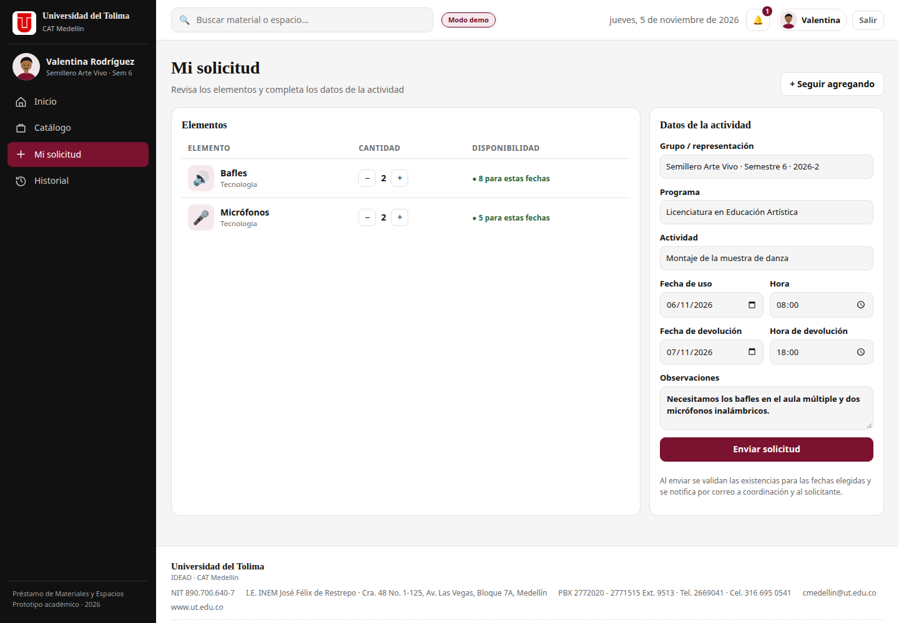
<figcaption><b>Figura 11.</b> Mi solicitud. La columna de disponibilidad se recalcula con las fechas y horas elegidas. El botón de envío solo se habilita cuando las cantidades son suficientes.</figcaption>
</figure>

### 6.4 Enviar y hacer seguimiento

Al enviar la solicitud:

- Se crea un número de solicitud, por ejemplo `UT-2026-0001`.
- La solicitud queda en estado **Pendiente**.
- La coordinación recibe una notificación y un correo.
- Tú recibes un correo de confirmación.
- La pantalla muestra el número de solicitud y accesos para ver el historial, los correos o volver al inicio.

Puedes seguir el estado desde **Historial**. Allí verás la actividad, los elementos, las fechas, el estado, las observaciones, la respuesta de coordinación y los correos asociados.

### 6.5 Cancelar una solicitud pendiente

Si ya no necesitas el préstamo y la solicitud aún está **Pendiente**:

1. Abre **Historial**.
2. Ubica la solicitud.
3. Pulsa **Cancelar solicitud** y confirma.

La solicitud pasa a **Cancelada**, se notifica a la coordinación y el historial conserva el registro. Una solicitud ya aprobada o en préstamo no se puede cancelar desde esta opción: en ese caso, contacta a la coordinación.

### 6.6 Editar el perfil

En **Mi perfil** puedes actualizar tu nombre, tu teléfono y tu contraseña. El correo institucional solo lo puede cambiar la administración. Si cambias la contraseña, debe tener al menos 6 caracteres.

### 6.7 Si eres docente

El flujo es el mismo, con dos diferencias:

- En **Mi solicitud** debes escribir el **curso o cátedra** que solicita el préstamo. El sistema lo usa como grupo o curso en la solicitud.
- La solicitud no se asocia a un grupo de estudiantes, sino al curso indicado.

Puedes consultar tus solicitudes y correos desde **Historial** y **Mis correos**.

## 7. Correos y notificaciones

### 7.1 La campana de notificaciones

La campana de la barra superior muestra las novedades de tu cuenta. El número rojo indica cuántas notificaciones sin leer tienes.

- Pulsa la campana para abrir el panel.
- Pulsa una notificación para ir a la solicitud o al historial relacionado.
- Pulsa **Marcar leídas** para limpiar el contador.

Las notificaciones se generan cuando se crea una solicitud, se aprueba, se rechaza, se ajusta, se entrega o se devuelve. La coordinación también recibe avisos de nuevas solicitudes y cancelaciones.

### 7.2 Correos simulados

Por defecto, la aplicación funciona en **modo demostración**. Esto significa que:

- Los correos se guardan en la bandeja interna.
- No se envían a buzones reales.
- El estado del mensaje es **Simulado**.
- Puedes ver el contenido, la plantilla y el destinatario.
- Puedes abrir el mensaje en tu cliente de correo con el enlace `mailto:`.

Los estudiantes y docentes ven sus mensajes en **Mis correos**. La administración y la coordinación ven la bandeja completa en **Correos**.

### 7.3 Activar el envío real con EmailJS

El envío real es opcional. Si se necesita que los correos lleguen a un buzón, se puede configurar EmailJS:

1. Crea una cuenta en [EmailJS](https://www.emailjs.com/).
2. Conecta un servicio de correo y crea una plantilla.
3. La plantilla debe aceptar las variables `{{to_email}}`, `{{to_name}}`, `{{subject}}`, `{{message}}`, `{{from_name}}` y `{{reply_to}}`.
4. En la aplicación, entra como administrador o coordinación.
5. Abre **Correos → Configurar envío real** o **Configuración → Configurar correo**.
6. Activa la casilla de envío real.
7. Escribe el **Service ID**, el **Template ID** y la **Public Key**.
8. Escribe un correo de prueba y pulsa **Enviar prueba**.
9. Guarda la configuración.

Si el envío falla, el correo queda en la bandeja con estado **Error** y el mensaje de error. La aplicación sigue funcionando normalmente.

> **Importante:** en GitHub Pages no hay backend. La clave pública de EmailJS queda visible en el navegador y la entrega no está garantizada. Para un sistema institucional se necesita un servidor que envíe los correos de forma segura.

### 7.4 Plantillas disponibles

| Plantilla | Cuándo se genera |
|---|---|
| Invitación | Al crear una cuenta. |
| Solicitud recibida | Al solicitante, cuando envía una solicitud. |
| Nueva solicitud | A coordinación y administración, cuando llega una solicitud. |
| Aprobación | Al solicitante, cuando se aprueba. |
| Rechazo | Al solicitante, con el motivo. |
| Ajuste | Al solicitante, cuando se ajustan cantidades. |
| Entrega | Al solicitante, cuando se registra la entrega. |
| Devolución | Al solicitante, cuando se recibe el material. |
| Cancelación | A coordinación, cuando el solicitante cancela. |
| Contraseña | Al usuario, cuando se restablece su clave. |
| Prueba | Al correo de prueba configurado. |

## 8. Instalar la PWA y usarla en el celular

Préstamos UT es una aplicación web progresiva. Esto significa que se puede abrir en el navegador y, si el navegador lo permite, instalar como una aplicación en el celular o en el computador.

### 8.1 Instalar desde el computador

1. Abre la aplicación en Chrome o Edge.
2. Busca el botón **⬇ Instalar app** en la barra superior. Si aparece, pulsa y confirma.
3. También puedes usar el menú del navegador y elegir **Instalar Préstamos UT** o **Agregar a la pantalla de inicio**.

La aplicación se abrirá en una ventana independiente y quedará disponible como un acceso directo.

### 8.2 Instalar desde el celular

- **Android (Chrome):** abre el menú de tres puntos y elige **Instalar aplicación** o **Agregar a la pantalla de inicio**.
- **iPhone (Safari):** pulsa el botón Compartir y elige **Agregar a la pantalla de inicio**.

La primera carga necesita conexión. Después, el service worker guarda los archivos principales para que la aplicación pueda abrirse con más facilidad. Los datos siguen viviendo en el navegador del dispositivo.

<figure class="fig-mobile">
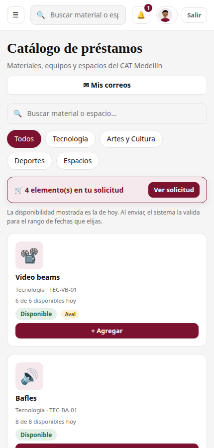
<figcaption><b>Figura 12.</b> Vista móvil del catálogo. El diseño responsive permite buscar, consultar disponibilidad y agregar elementos desde el teléfono.</figcaption>
</figure>

> **Importante:** cada navegador y cada dispositivo tiene su propia copia de los datos. Las cuentas, solicitudes y correos creados en un computador no aparecen automáticamente en otro. Esta versión no sincroniza información entre dispositivos.

## 9. Solución de problemas

| Situación | Posible causa | Qué hacer |
|---|---|---|
| No veo los últimos cambios después de actualizar. | La PWA conserva archivos en caché. | Recarga con `Ctrl + Shift + R` (o `Cmd + Shift + R` en Mac). Si persiste, abre las herramientas del navegador → **Application → Service Workers → Unregister** y luego **Storage → Clear site data**. Vuelve a cargar. |
| La página no carga o se ve incompleta. | Se abrió con `file://` o el servidor no está activo. | Sirve la carpeta por HTTP, por ejemplo `python3 -m http.server 8080`, y abre `http://localhost:8080/`. |
| El correo o la contraseña no funcionan. | Credenciales incorrectas o cuenta desactivada. | Verifica mayúsculas y minúsculas. Si la cuenta está desactivada, pide al administrador que la active o restablezca la clave. |
| No aparece la opción **Instalar app**. | El navegador no cumple las condiciones de instalación o no se sirve por HTTPS/localhost. | Usa Chrome o Edge, abre la aplicación por `https://` o `localhost` y revisa el menú del navegador. |
| No puedo crear un estudiante. | No hay grupos activos. | Crea primero un grupo en **Grupos** y vuelve a **Usuarios**. |
| Un estudiante no puede enviar una solicitud. | No tiene grupo asignado. | Edita el usuario en **Usuarios** y asígnale un grupo activo. |
| No hay disponibilidad para las fechas elegidas. | Otra solicitud ocupa el material en ese rango o no hay unidades suficientes. | Cambia las fechas, reduce la cantidad o elige otro recurso. La coordinación también puede ajustar la solicitud. |
| No puedo aprobar una solicitud. | Algún elemento no tiene disponibilidad suficiente. | Usa **Ajustar a disponibilidad** o rechaza la solicitud con un motivo. |
| No puedo dejar el inventario con menos unidades. | Hay unidades prestadas o reservadas. | Espera a que se devuelvan o registra primero la devolución. Revisa el total y las unidades fuera de servicio. |
| No llegan correos a mi buzón. | La aplicación está en modo simulado. | Revisa **Correos** o **Mis correos**. Si necesitas envío real, configura EmailJS y prueba la conexión. |
| No puedo desactivar mi propia cuenta. | Es una protección del sistema. | Pide a otro administrador que realice el cambio. |
| Los datos desaparecieron. | Se restableció la demostración o se limpió el almacenamiento del navegador. | Descarga un respaldo con frecuencia. Si reiniciaste la demo, vuelve a crear los datos. |
| La aplicación se ve diferente en otro equipo. | Cada navegador tiene su propia copia local. | Es el comportamiento esperado en esta versión. No hay sincronización entre dispositivos. |
| El envío real de EmailJS falla. | Credenciales incorrectas, plantilla incompatible o límite del servicio. | Revisa Service ID, Template ID, Public Key y las variables de la plantilla. Consulta el estado **Error** en la bandeja. |

### 9.1 Si la aplicación no responde

1. Recarga la página.
2. Cierra y vuelve a abrir el navegador.
3. Verifica que el servidor local siga activo.
4. Abre la consola del navegador y revisa si hay errores en rojo.
5. Si el problema continúa, limpia la caché y el almacenamiento del sitio, y vuelve a cargar.

> **Consejo:** antes de una presentación, prueba el flujo completo en el mismo navegador y con el mismo equipo que vas a usar. Así evitas diferencias de caché, resolución o permisos.

## 10. Buenas prácticas y cierre

### 10.1 Buenas prácticas de uso

- Usa **datos ficticios** durante la demostración. No ingreses documentos, teléfonos o correos de personas reales.
- Asigna a cada estudiante un grupo activo antes de que solicite.
- Revisa la disponibilidad para las fechas antes de aprobar.
- Registra la entrega solo cuando el material esté físicamente entregado.
- Registra las devoluciones con novedades en el mismo momento en que se recibe el material.
- Escribe motivos claros cuando rechaces o ajustes una solicitud.
- Descarga un respaldo antes de reiniciar la demostración.
- Cierra sesión al terminar en un equipo compartido.

### 10.2 Lista de verificación para la presentación

1. Abrir la aplicación y comprobar que carga.
2. Ingresar como administrador.
3. Mostrar el panel y los indicadores.
4. Crear un grupo y un usuario de estudiante.
5. Abrir la invitación en **Correos**.
6. Cerrar sesión e ingresar con el estudiante.
7. Agregar materiales al catálogo y enviar una solicitud.
8. Ingresar como coordinación y aprobar la solicitud.
9. Registrar la entrega y mostrar el descuento del inventario.
10. Registrar la devolución y mostrar la restauración del inventario.
11. Revisar el historial, las notificaciones y los correos.
12. Abrir **Reportes** y exportar el CSV o guardar el PDF.

### 10.3 Limitaciones que debes explicar

Esta versión es una demostración académica. Todavía no reemplaza un sistema institucional porque:

- No tiene backend ni base de datos central.
- No tiene autenticación segura: las contraseñas están en el código y en el almacenamiento local.
- No sincroniza datos entre dispositivos o personas.
- No envía correos reales por defecto.
- No tiene auditoría externa ni control de concurrencia.
- No debe usarse con datos personales reales.

La ruta para una versión de producción está documentada en el informe técnico y en los documentos de arquitectura del proyecto.

### 10.4 Contacto y soporte

Para dudas sobre el uso de la aplicación, contacta a la coordinación del CAT Medellín:

- **Correo:** [cmedellin@ut.edu.co](mailto:cmedellin@ut.edu.co)
- **Teléfono:** 2669041 · Cel. 316 695 0541
- **Dirección:** I.E. INEM José Félix de Restrepo · Carrera 48 No. 1-125, Avenida Las Vegas, Bloque 7A, Medellín
- **Horario:** martes a viernes de 8:00 a. m. a 12:00 m. y de 2:00 p. m. a 6:00 p. m.; sábado de 7:00 a. m. a 3:00 p. m.

## Anexo A. Credenciales y flujo rápido

### A.1 Credenciales de demostración

| Rol | Correo | Contraseña | Uso recomendado |
|---|---|---|---|
| Administrador | `admin@ut.edu.co` | `admin2026` | Crear usuarios, grupos, inventario y configuración. |
| Coordinación | `coordinacion.cat@ut.edu.co` | `cat2026` | Aprobar, entregar, devolver y reportar. |

> **Importante:** estas credenciales son públicas dentro del prototipo y sirven únicamente para la demostración. No las uses en un sistema real.

### A.2 Flujo rápido de una solicitud

1. **Administrador:** crea un grupo en **Grupos**.
2. **Administrador:** crea un estudiante en **Usuarios** y asígnale el grupo.
3. **Administrador:** revisa la invitación en **Correos**.
4. **Estudiante:** ingresa, abre **Catálogo**, agrega elementos y envía la solicitud.
5. **Coordinación:** abre **Solicitudes**, revisa y aprueba.
6. **Coordinación:** registra la **entrega** y verifica el inventario.
7. **Coordinación:** registra la **devolución** y las novedades.
8. **Administrador o coordinación:** revisa **Reportes** y exporta la evidencia.

### A.3 Navegación por rol

| Rol | Menú visible |
|---|---|
| Administrador | Panel principal, Solicitudes, Inventario, Devoluciones, Usuarios, Grupos, Correos, Reportes, Configuración. |
| Coordinación | Panel principal, Solicitudes, Inventario, Devoluciones, Correos, Reportes. |
| Estudiante y docente | Inicio, Catálogo, Mi solicitud, Historial. |

## Anexo B. Glosario

| Término | Definición |
|---|---|
| **Aval** | Autorización docente o de dirección que algunos elementos requieren para ser prestados a estudiantes. |
| **Bandeja de correos** | Registro interno de los mensajes generados por la aplicación. En modo demostración no salen a internet. |
| **Disponibilidad** | Cantidad de un elemento que puede prestarse en un rango de fechas y horas, después de restar unidades fuera de servicio y comprometidas. |
| **Entrega** | Momento en que el material sale físicamente del CAT y se descuenta del inventario. |
| **Estado** | Etapa del ciclo de una solicitud: Pendiente, Aprobada, En préstamo, Devuelta, Rechazada o Cancelada. |
| **Grupo** | Semillero, club, representación o grupo de curso al que pertenece un estudiante. |
| **Novedad** | Registro de una unidad dañada o no devuelta durante la devolución. |
| **PWA** | Aplicación web progresiva: se abre en el navegador y puede instalarse como una aplicación. |
| **Representante** | Estudiante que actúa como contacto de un grupo. |
| **Solicitud** | Petición de uno o varios elementos para una actividad, con fechas y cantidades. |
| **Service worker** | Componente del navegador que guarda archivos en caché y permite que la PWA funcione con mayor disponibilidad. |
| **Unidad fuera de servicio** | Unidad dañada, perdida o no disponible que se resta del inventario. |

---

<b>Fin del manual.</b> Préstamos UT · Universidad del Tolima · IDEAD · CAT Medellín · Versión 1.0 · noviembre de 2026.

